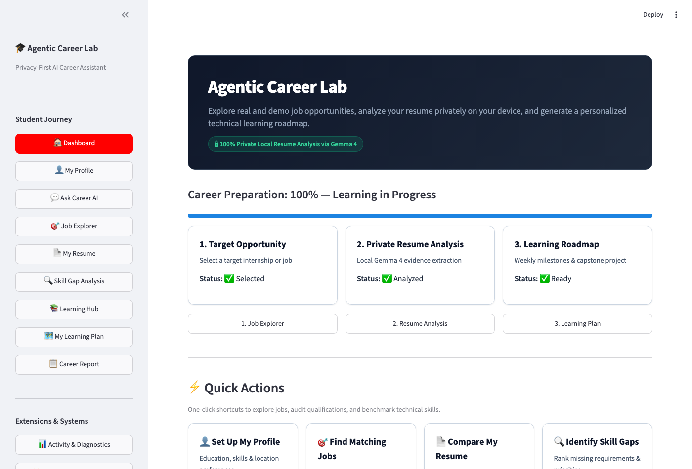
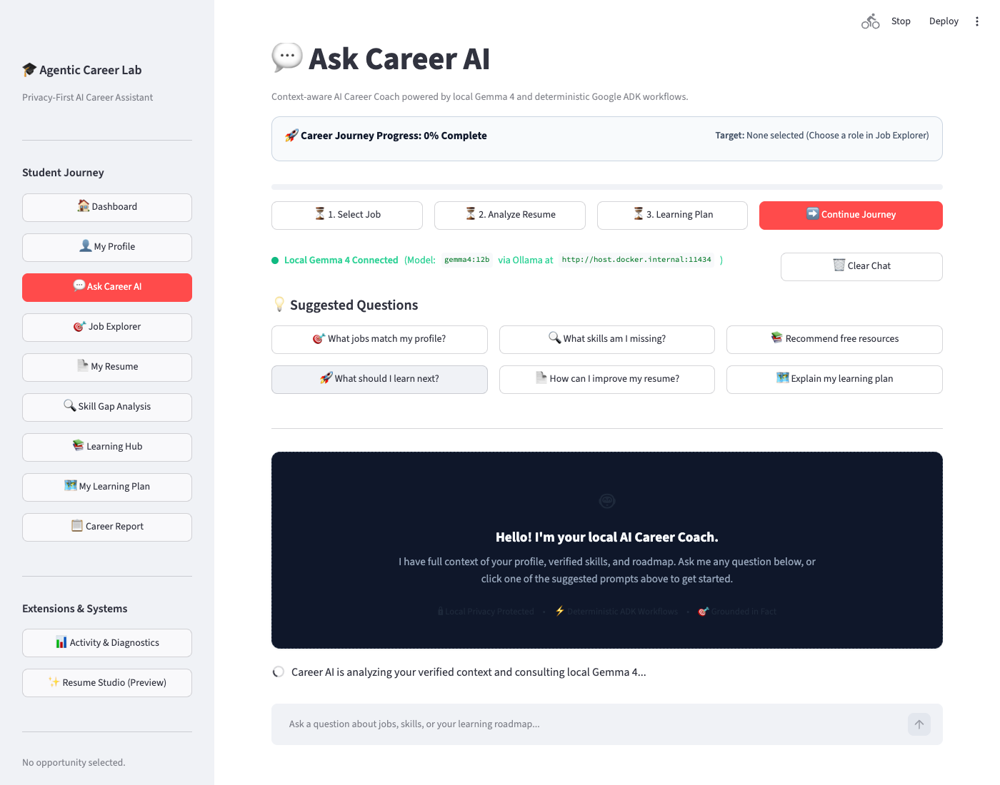
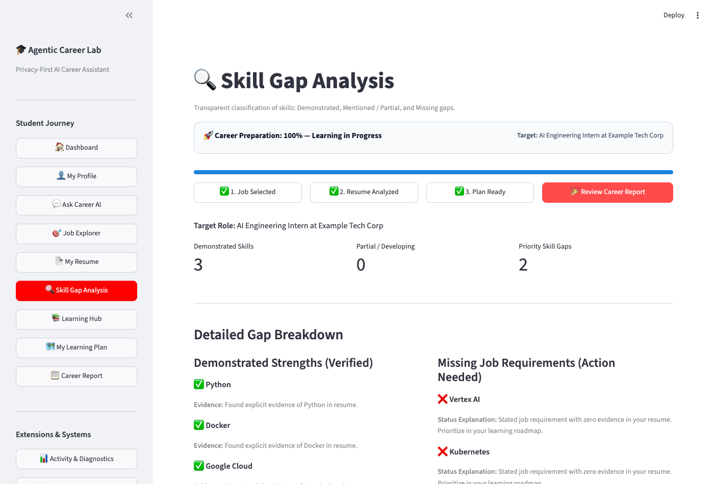
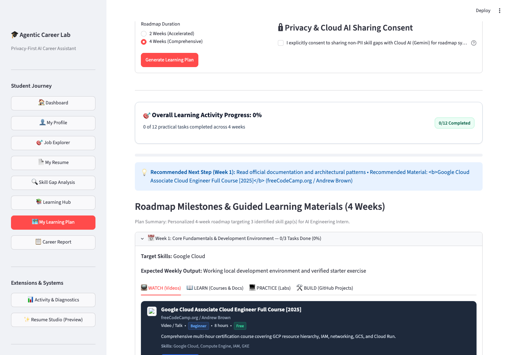

# Agentic Career Lab

<p align="center">
  <b>A Privacy-First, Multi-Agent AI Career Assistant</b><br/>
  <i>Empowering students and job seekers with evidence-grounded career planning, local AI resume intelligence, and actionable upskilling.</i>
</p>

<p align="center">
  <a href="https://github.com/hastimal/agentic-career-lab/releases/tag/v0.10.0"></a>
  <a href="pyproject.toml"></a>
  <a href="https://google.github.io/adk-docs/"></a>
  <a href="https://ai.google.dev/gemma"></a>
  <a href="https://ollama.ai"></a>
  <a href="https://www.docker.com/"></a>
  <a href="https://github.com/hastimal/agentic-career-lab/actions/workflows/ci.yml"></a>
  <a href="LICENSE"></a>
</p>

---

## 🌟 Executive Summary

**Agentic Career Lab** is an open-source, evidence-grounded career guidance platform designed for college students and technical job seekers. It pairs **Google ADK** multi-agent registration and tool adapters with **local Gemma 4** (`gemma4:12b` via native Ollama) for private resume analysis, providing structured roadmaps and real-time interactive actions through a modern **Streamlit** application.

---

## 📸 See It in Action

Real screenshots captured directly from the live **v0.10.0** application:

| **1. Student Dashboard** | **2. Ask Career AI Assistant** |
| :---: | :---: |
| [](docs/images/ui-dashboard.png)<br/><sub>*Quick actions, target role metrics, and persistent career journey tracking.*</sub> | [](docs/images/ui-agent-chat.png)<br/><sub>*Streaming multi-turn guidance powered by local Gemma 4 with interactive action buttons.*</sub> |
| **3. Skill Gap Analysis** | **4. Guided Learning Plan** |
| [](docs/images/ui-skill-gap-analysis.png)<br/><sub>*Explainable 3-tier categorization: Demonstrated, Mentioned, and Missing skills.*</sub> | [](docs/images/ui-learning-plan.png)<br/><sub>*Tailored weekly roadmap across WATCH, LEARN, PRACTICE, and BUILD modalities.*</sub> |

> 📸 *For the complete inventory of all 10 verified application screens, see the [Screenshot Manifest](docs/images/SCREENSHOT-MANIFEST.md).*

---

## 🏛️ How It Works

Agentic Career Lab coordinates specialist agents across clear boundaries. The Streamlit interface connects to the **CareerChatOrchestrator** and **Google ADK Coordinator**, dispatching domain tools across local and optional cloud environments.



### Verified Architecture Components:
- **Streamlit Application (`app.py`):** High-performance UI shell with real-time token streaming and navigation state machine.
- **Ask Career AI (`chat/`):** Conversational engine integrating progressive local Ollama streaming with grounded tool calling.
- **Google ADK Coordinator (`coordinator/adk_coordinator.py`):** Registers specialized specialist agents (`job_scout`, `private_resume_agent`, `skill_builder`) and exposes typed tool wrappers.
- **Job Scout Agent (`agents/job_scout/`):** Discovers verified opportunities and normalizes job requirements deterministically.
- **Private Resume Agent (`agents/resume_agent/`):** Evaluates uploaded resumes strictly in memory via local Gemma 4, enforcing factual grounding.
- **Skill Builder Agent (`agents/skill_builder/`):** Calculates requirement matches and maps missing skills to canonical resources.
- **Grounded Career Tools (`chat/tools.py`):** Typed adapters (`find_jobs`, `recommend_resources`, `explain_skill_gaps`) providing validated parameters.

> 💡 *For low-level container topology, Tempo tracing, and Prometheus metrics, see the [Docker & Observability Architecture](docs/architecture.md).*

---

## 🔒 Privacy First

Privacy is a non-negotiable architectural boundary in Agentic Career Lab. We guarantee that your private documents remain strictly under your control.



### Core Privacy Guarantees:
1. **Local-First Default:** All resume parsing, skill evidence extraction, and chat reasoning run on your host machine via Ollama (`gemma4:12b`).
2. **Zero Default Cloud Inference:** Cloud AI endpoints are completely disabled unless affirmative, recorded consent (`cloud_consent=True`) is explicitly granted.
3. **Strict Payload Allowlist:** When optional cloud planning is activated, the privacy guard transmits only high-level skill names and target titles. Raw resume text, personal contact information, and PDF bytes are **never** transmitted.
4. **Offline Fallback Engine:** If cloud consent is denied or external networks are unavailable, a deterministic Python planner generates comprehensive curricula directly from the local 104-item catalog.
5. **Sanitized Telemetry:** Observability traces (OpenTelemetry, Prometheus, Tempo) automatically redact prompts, completions, and student PII.

---

## 🎯 Key Features & Capabilities (v0.10.0)

- **💬 Multi-Turn "Ask Career AI":** Context-aware career mentor answering queries about readiness, missing skills, and interview preparation.
- **⚡ Real-Time Gemma 4 Streaming:** Progressive token streaming directly in Streamlit via native Ollama streaming (`httpx.stream`) with clear visual progress states.
- **🎮 5 Interactive Career Actions:**
  - `SELECT_JOB`: Binds an opportunity to your session and invalidates stale comparisons.
  - `OPEN_SKILL_GAP_ANALYSIS`: Routes directly to the evidence-based requirement breakdown.
  - `OPEN_LEARNING_RESOURCE`: Opens curated HTTPS resources directly from the 104-item catalog.
  - `CONTINUE_LEARNING`: Navigates to your next incomplete task in My Learning Plan.
  - `VIEW_CAREER_REPORT`: Opens the exportable comprehensive Markdown career summary.
- **🧭 Interactive Career Journey Tracker:** Clickable 3-stage progress tracker (`1. Job Selected` → `2. Resume Analyzed` → `3. Learning Plan Ready`).
- **📚 Curated 104-Resource Learning Catalog:** High-quality learning materials organized by modality:
  - 📺 **WATCH:** YouTube tutorials and architectural deep dives from engineering leaders.
  - 📖 **LEARN:** Official documentation, standard certification curricula, and textbooks.
  - 💻 **PRACTICE:** Interactive code katas, sandboxes, and cloud labs.
  - 🛠️ **BUILD:** Real-world capstone projects, open-source repositories, and portfolio deliverables.

---

## 🚀 Quickstart Guide

### Option A: Docker Compose (Recommended)

Run the full application stack connected to your host Ollama instance:

```bash
# 1. Clone the repository
git clone https://github.com/hastimal/agentic-career-lab.git
cd agentic-career-lab

# 2. Start local Ollama with Gemma 4 (Host)
ollama run gemma4:12b

# 3. Start the application stack
docker compose up -d
```

Open **[http://localhost:8501](http://localhost:8501)** in your browser.

- **Streamlit App:** `http://localhost:8501`
- **Grafana Dashboards:** `http://localhost:3000` (admin / admin)
- **Prometheus Metrics:** `http://localhost:9090`

---

### Option B: Local Python Development

```bash
# 1. Install uv package manager (https://docs.astral.sh/uv/)
uv venv
source .venv/bin/activate
uv sync --all-extras

# 2. Run Streamlit
uv run streamlit run src/agentic_career_lab/app.py
```

---

## 🧪 Testing & Quality Gates

Every release is validated with automated unit tests, linter checks, and Playwright browser suites:

```bash
# Code style and formatting
uv run ruff check .
uv run ruff format --check .

# Fast unit & integration test suite (102 tests)
uv run pytest

# Automated Playwright browser verification across all 10 student workflows
uv run python scripts/test_browser_acceptance.py

# Automated Playwright verification of all 5 interactive chat actions
uv run python scripts/test_browser_actions.py
```

---

## 🗺️ Roadmap & Community

- **Latest Release:** [v0.10.0 Release Notes](https://github.com/hastimal/agentic-career-lab/releases/tag/v0.10.0)
- **Product Roadmap:** [docs/ROADMAP.md](docs/ROADMAP.md) (v0.11.0 Resume Studio through v0.15.0 Learning Experience)
- **Contribution Guidelines:** [CONTRIBUTING.md](CONTRIBUTING.md)
- **Security & Privacy Policy:** [SECURITY.md](SECURITY.md)
- **Code of Conduct:** [CODE_OF_CONDUCT.md](CODE_OF_CONDUCT.md)
- **Issue Tracker:** [GitHub Issues](https://github.com/hastimal/agentic-career-lab/issues)
- **Known Limitations:** [docs/known-issues.md](docs/known-issues.md)

---

<p align="center">
  <sub>Built with ❤️ by Hastimal Jangid and community contributors. Distributed under the MIT License.</sub>
</p>
