# Agentic Career Lab

A privacy-first hybrid multi-agent career platform for students and technical job seekers.

**Core Technology Stack**:
- **Google ADK** (Multi-Agent Coordinator)
- **Local Gemma 4 on Ollama** (100% Private Resume Analysis & Evidence Extraction)
- **Optional Gemini / Vertex AI** (Cloud Reasoning with Explicit Consent)
- **Streamlit** (Responsive Student UI Shell & Interactive Career Journey Tracker)
- **Docker & Docker Compose** (Container-First Deployment & Packaging)
- **OpenTelemetry, Prometheus, Tempo & Grafana** (End-to-End Tracing & Observability)

---

## 📸 Student Application Preview

| Modern Student Dashboard | My Profile & Target Role | Job Explorer & Opportunities |
| :---: | :---: | :---: |
| [](docs/images/ui-dashboard.png) | [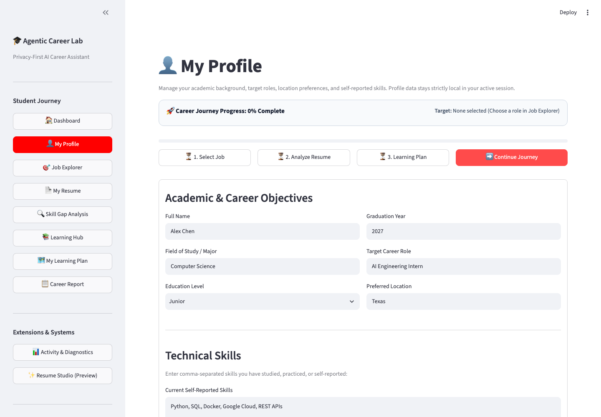](docs/images/ui-my-profile.png) | [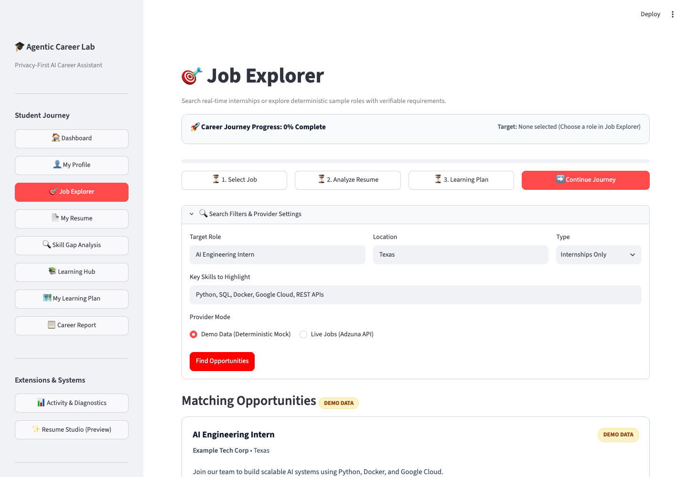](docs/images/ui-job-explorer.png) |
| **Private Resume Analysis** | **Transparent Skill Gap Breakdown** | **Verified Learning Hub** |
| [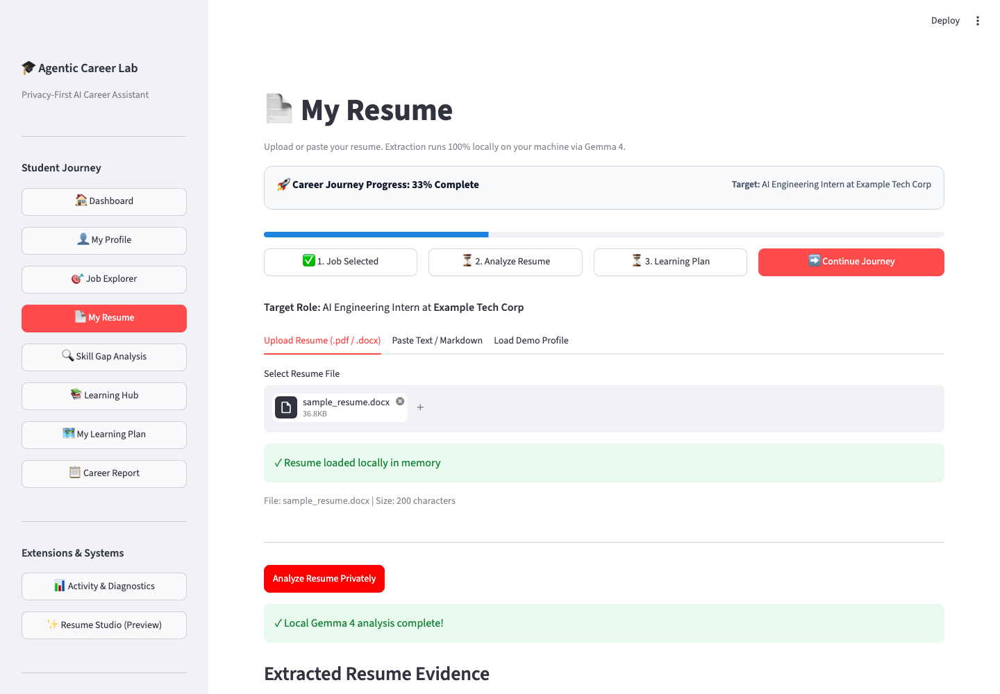](docs/images/ui-my-resume.png) | [](docs/images/ui-skill-gap-analysis.png) | [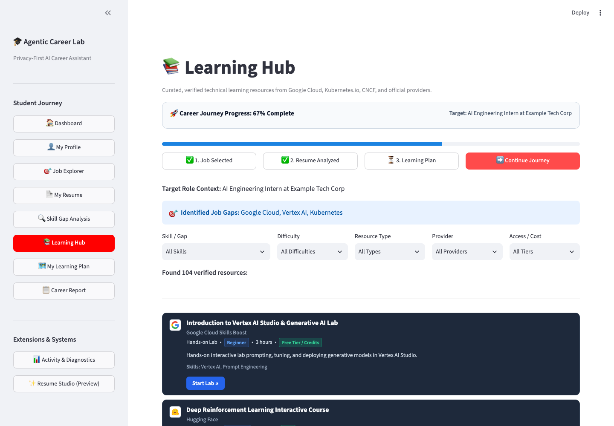](docs/images/ui-learning-hub.png) |
| **Guided Learning Plan** | **Exportable Career Report** | **Milestone Diagnostics** |
| [](docs/images/ui-learning-plan.png) | [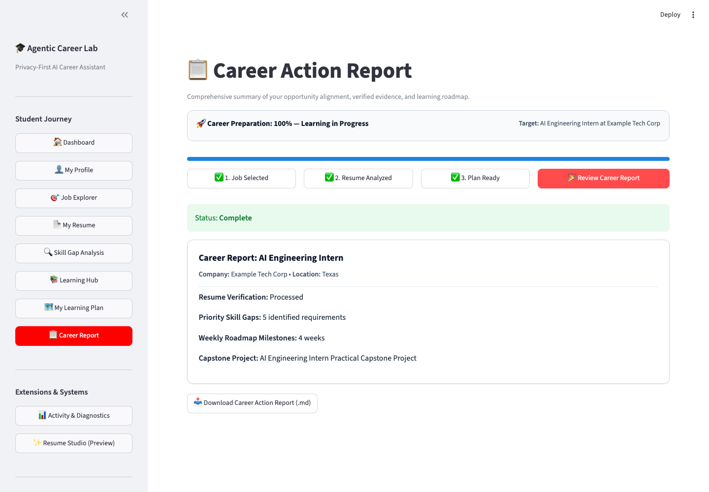](docs/images/ui-career-report.png) | [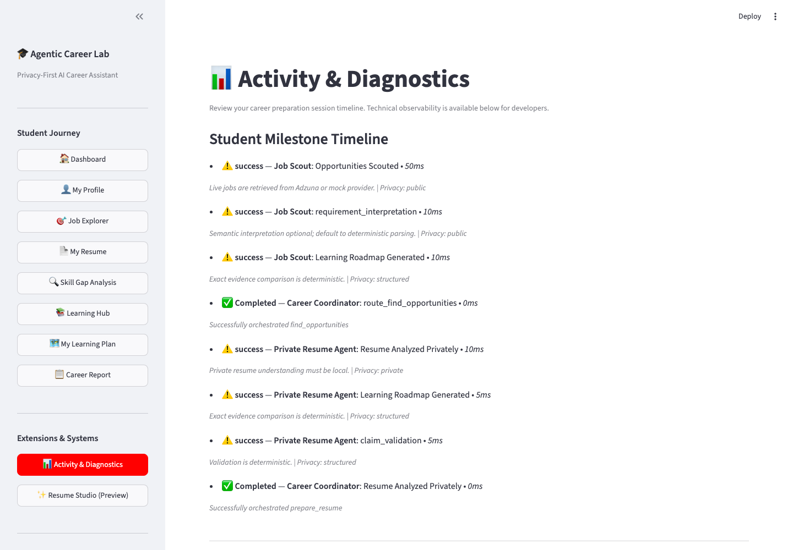](docs/images/ui-activity-diagnostics.png) |

> ℹ️ *For the complete inventory of all 10 verified application screenshots, see the [Screenshot Manifest](docs/images/SCREENSHOT-MANIFEST.md).*

---

## 🚀 Key Highlights & Capabilities (v0.9.0)

- **🔒 100% Private Local Resume Processing:** Your resume text, contact details, and work history are parsed and analyzed entirely on your device using **Gemma 4** (`gemma4:12b`) running via local Ollama. Raw resume data is never transmitted to cloud AI or external providers.
- **🧭 Interactive Career Journey Progress Tracker:** Clickable, persistent 3-stage tracker (`1. Job Selected` → `2. Resume Analyzed` → `3. Learning Plan Ready`) across all primary student screens with dynamic "Continue Journey" navigation.
- **👤 Dedicated Student Profile:** Manage field of study, graduation year, target role, and location preferences with clear visual separation between self-reported profile skills and verified resume evidence.
- **💼 Job Explorer with Transparent Sourcing:** Explore real internships via Adzuna or evaluate deterministic sample roles with clear `DEMO DATA` vs `LIVE` indicators and verifiable requirement links.
- **🔍 Explainable Skill Gap Analysis:** Transparent 3-category evaluation: Demonstrated Strengths (verified with concrete resume evidence), Mentioned/Partial Skills (keyword/coursework only), and Missing Job Requirements with actionable explanations.
- **📚 Curated 104-Resource Learning Catalog:** High-quality multi-modal learning materials across 4 distinct learning modalities:
  - **📺 WATCH**: 45 verified YouTube videos and tech conference tutorials (Nana, freeCodeCamp, Fireship, Corey Schafer, Karpathy, etc.).
  - **📖 LEARN**: Structured courses, official documentation, and guides (Google Cloud, CNCF, Kubernetes, Python PSF).
  - **💻 PRACTICE**: Hands-on interactive sandbox labs (Killercoda, Google Cloud Skills Boost, PGExercises).
  - **🛠️ BUILD**: Canonical open-source repositories and portfolio architectures (Google Cloud Microservices Demo, FastAPI, etc.).
- **🎨 Compact Resource Cards with Provider Favicons:** Clean dark-mode cards with small, official 24–32px provider icons (Google Cloud, Docker, YouTube, GitHub, Hugging Face, AWS, etc.), difficulty/duration chips, and direct canonical action buttons without oversized video thumbnails or banners.
- **🗺️ Guided Weekly Learning Plan:** Strict 2-week (Fast-Track) or 4-week (Comprehensive) roadmaps with milestone deliverables, evidence notes fields, and independent progress calculations decoupled from the top-level Career Journey Tracker.
- **💡 "Continue Learning" Action Recommendation:** Proactive recommendation banner highlighting the student's next incomplete weekly task and associated learning material.
- **📊 Exportable Markdown Career Report:** Compile readiness metrics, verified evidence, skill gaps, roadmap milestones, and capstone projects into an ATS-ready Markdown action plan.
- **🔭 Clean Activity & Diagnostics:** Student-facing milestone timeline paired with collapsed developer OpenTelemetry spans, sanitized telemetry, and pre-configured Grafana/Tempo integration.

---

## 🏛️ System Architecture


---

## 🗺️ Engineering Milestone Progress

- [x] **Milestone 1: Foundation + UI Shell** — Complete
- [x] **Milestone 2: Job Scout Agent** — Complete
- [x] **Milestone 3: Private Resume Agent with Gemma 4 + Ollama** — Complete
- [x] **Milestone 4: Skill Builder Agent** — Complete
- [x] **Milestone 5: Google ADK Multi-Agent Coordinator** — Complete
- [x] **Milestone 6: Hybrid Gemini + Gemma Routing** — Complete
- [x] **Milestone 7: Docker-First Application Distribution** — Complete
- [x] **Milestone 8: OpenTelemetry + Grafana Observability & Evaluation** — Complete
- [x] **v0.9.0: Streamlit Redesign, Learning Hub & Compact Guided Learning** — Release Ready Candidate

---


## 🔀 Hybrid Gemini + Gemma Privacy Routing (Milestone 6)

Milestone 6 provides a working end-to-end multi-agent career preparation demo enforcing strict data privacy boundaries:
- **Local Gemma 4 Inference**: Private resume parsing, evidence extraction, and suggestion validation run locally via Ollama (`gemma4:12b`). Raw resume content is never transmitted to cloud models.
- **Cloud Gemini Reasoning**: Generates customized learning plans and portfolio project recommendations with `gemini-3.6-flash` / `gemini-3.8-flash` via Vertex AI / Gemini API.
- **Explicit Cloud Consent**: Streamlit UI includes explicit student consent toggles before sharing sanitized skill gap metadata with cloud AI. Declining consent gracefully falls back to deterministic Python planning.
- **Google ADK Orchestration**: Sequences Job Scout, Private Resume Agent, and Skill Builder through typed boundaries and compiles the final Career Action Plan.

### Hybrid Multi-Agent Workflow
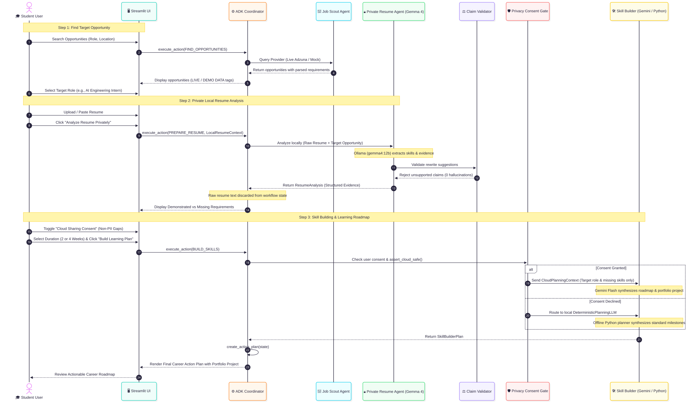

### Strict Local vs. Cloud Privacy Boundary


---

## 🔄 End-to-End Resume-to-Career-Plan Pipeline


---

## 🐳 Container & Observability Architecture (Milestones 7 & 8)


---


## 🎓 Google ADK Coordinator (Milestone 5)

Gemini reasons. Gemma handles private resume intelligence locally. Python verifies deterministic facts. Google ADK coordinates the workflow.

- **Orchestration**: Directs flow between Job Scout, Private Resume Agent, and Skill Builder.
- **Privacy Boundary**: Guarantees raw resume data remains strictly in local models while sharing only structured outputs with the coordinator.
- **Partial Failures**: Cleanly handles situations like an offline Ollama instance without destroying prior job scout sessions.

---

## 🎯 Job Scout Agent (Milestone 2)

The Job Scout Agent provides evidence-backed opportunity matching:

- **Provider Abstraction**: Allows fetching opportunities securely (currently featuring a deterministic mock provider for testing).
- **Source Preservation**: Every opportunity is tied to a verifiable external source URL to eliminate hallucinated job postings.
- **Requirement Extraction**: Parses requirements securely from job descriptions.
- **Skill Normalization**: Translates equivalent terms (e.g., `GCP` to `Google Cloud`, `k8s` to `Kubernetes`).
- **Explainable Matching**: Categorizes requirements into `Demonstrated`, `Partial`, and `Missing` using deterministic validation rather than arbitrary percentages.

**Limitations**: Currently runs via deterministic execution and mock data for UI safety. Live provider API integrations arrive in later milestones.

```text
Student Profile
      |
      v
Job Scout
      |
      v
Opportunity Provider
      |
      v
Requirement Extraction
      |
      v
Skill Matching
      |
      v
Evidence-Backed Results
```

## 🔒 Private Resume Agent (Milestone 3)

The Private Resume Agent ensures privacy by analyzing resumes strictly via a local Gemma 4 model through Ollama.

- **Local Inference**: Raw resume text is **never** transmitted to Gemini or Vertex AI.
- **Evidence Extraction**: Identifies skills, technologies, and experience strictly present in the resume.
- **Requirement Mapping**: Maps extracted evidence against job requirements to flag missing gaps.
- **Deterministic Validation**: Guardrails ensure that AI-suggested rewrites do not hallucinate new metrics, skills, or employers.
- **Safe Fallback**: If Ollama is unavailable, the agent fails gracefully locally and will not invoke cloud models.

```text
Resume
   |
   v
Gemma 4 / Ollama
   |
   v
Evidence Extraction
   |
   v
Requirement Mapping
   |
   v
Resume Suggestions
   |
   v
Claim Validator
```

## 🛠️ Skill Builder Agent & Guided Learning Platform (Milestone 4 & v0.9.0)

The Skill Builder helps bridge the gap between your verified resume and the target role by producing an evidence-grounded, multi-modal learning plan:

- **Deterministic Gaps**: Uses standard Python logic to identify and prioritize gaps based on requirements and M3 evidence.
- **Priority Ranking**: Rules-based approach to score gaps (High/Medium/Low).
- **Multi-Modal Guided Learning (v0.9.0)**:
  - **📺 WATCH**: Curated YouTube tutorials and technical demos from verified engineering sources.
  - **📖 LEARN**: Structured courses, certification paths, and official documentation (Google Cloud, CNCF, Kubernetes, Python).
  - **💻 PRACTICE**: Interactive hands-on labs and exercises.
  - **🛠️ BUILD**: GitHub reference architectures, open-source codebases, and capstone project deliverables.
- **Task-Resource Integration**: Weekly checklist tasks link directly to canonical learning resources with practical evidence inputs (GitHub repo links, lab verification, notes).
- **Dual Progress Decoupling**: Tracks overall and weekly learning completion independently from the high-level 3-stage Career Journey Progress Tracker.
- **Privacy Focus**: Minimizes sharing by generating plans 100% locally when cloud AI consent is declined, with zero raw resume data ever sent over the network.


---

## 🎨 Planned Feature: Resume Studio (AI Resume Builder + Progress Tracker)

*(Planned for integration post-M7/M8 stabilization, targeted prior to v1.0.0 — Not yet implemented)*

The upcoming **Resume Studio** extends the workflow into an interactive lifecycle loop:
- **Continuous Progress Tracking**: Track skills across states (`Not Started` → `Learning` → `Completed` → `Demonstrated`).
- **Local Conversational Evidence Gathering**: Multi-turn dialogue powered by local Gemma 4 on Ollama to explore student projects, codebase accomplishments, and artifacts without sending resumes or personal data to cloud services.
- **Strict Evidence Verification**: Clear separation of self-reported claims from independently verifiable evidence (e.g. GitHub repos, Dockerfiles). Unverified skills are never claimed automatically.
- **Side-by-Side Diff Review**: Proposes grounded resume bullet revisions with visual before/after diffs requiring explicit student approval.
- **ATS-Friendly Export & Versioning**: Generates clean DOCX and PDF documents while preserving immutable version history and rollback capabilities.
- **Dynamic Gap Recalculation**: Immediately updates job readiness scores and skill gap analyses upon approving resume revisions.


For complete technical specifications, data models, and acceptance criteria, see [docs/features/resume-studio.md](docs/features/resume-studio.md).

---


## 🐳 Docker Quick Start (Recommended)

Run the entire application with Docker Compose in a single command:

```bash
# 1. Clone the repository
git clone https://github.com/hastimal/agentic-career-lab.git
cd agentic-career-lab

# 2. Configure environment (optional overrides)
cp .env.example .env

# 3. Start the application
docker compose up -d
```

Open **[http://localhost:8501](http://localhost:8501)** in your browser.

### Ollama Runtime Modes & Platform Guidance

- **macOS / Apple Silicon (M1/M2/M3/M4) [Recommended]**:
  Run Ollama natively on macOS (`brew install ollama` or via Ollama Desktop app) and pull Gemma 4:
  ```bash
  ollama run gemma4:12b
  ```
  The container connects automatically to `http://host.docker.internal:11434` with **full Metal GPU acceleration** (Docker Desktop for macOS does not support Metal GPU passthrough to Linux containers).

- **Linux / Standalone (Containerized Ollama)**:
  If running without native Ollama, start the containerized Ollama service using the standalone profile:
  ```bash
  docker compose --profile standalone up -d
  # Download Gemma 4 model into the persistent container volume:
  docker exec -it agentic-career-lab-ollama ollama pull gemma4:12b
  ```

- **🔭 Optional Observability Stack (Grafana, Prometheus, Tempo, OTel Collector)**:
  Launch the complete observability stack alongside the application:
  ```bash
  docker compose --profile observability up -d
  ```
  - **Streamlit App**: [http://localhost:8501](http://localhost:8501)
  - **Grafana Dashboard**: [http://localhost:3000](http://localhost:3000) (pre-configured with Prometheus & Tempo)
  - **Prometheus Metrics**: [http://localhost:9090](http://localhost:9090)
  - **Tempo Traces**: [http://localhost:3200](http://localhost:3200)

- **Stopping the Application**:
  ```bash
  docker compose down
  ```


---

## 🛠️ Local Development Quick Start (Virtual Environment)

```bash
# Clone repository
git clone https://github.com/hastimal/agentic-career-lab.git
cd agentic-career-lab

# Create and activate virtual environment
python3 -m venv .venv
source .venv/bin/activate

# Install dependencies in editable mode
pip install -e ".[dev]"
```

### 2. Environment Configuration

Copy the example environment file:

```bash
cp .env.example .env
```

### 3. Run Streamlit UI Shell

```bash
streamlit run src/agentic_career_lab/app.py
```

---

## 🧪 Testing, Quality Gates & Acceptance

Run the automated verification suite using `uv`:

```bash
# Code standards & formatting
uv run ruff check .
uv run ruff format --check .

# Full unit and regression test suite (75 tests)
uv run pytest

# End-to-end browser acceptance suite across all 10 student workflows
uv run python scripts/test_browser_acceptance.py
```

### Verified Test Results (v0.9.0 Candidate)
- **Ruff Linter & Formatter**: 75 files checked, 100% compliant.
- **Pytest Suite**: 75 passed (including deterministic roadmaps, consent boundaries, provider icons, and catalog metadata).
- **Playwright Browser Acceptance**: 10/10 student workflows verified live on Docker (`http://localhost:8501`).

---

## ⚠️ Known Limitations & Future Roadmap

For an honest assessment of current limitations (such as in-session learning progress persistence and planned future features), see:
- [docs/known-issues.md](docs/known-issues.md) — Comprehensive v0.9.0 known issues and roadmap (v0.10.0–v0.12.0).
- [docs/images/SCREENSHOT-MANIFEST.md](docs/images/SCREENSHOT-MANIFEST.md) — Detailed screenshot inventory and visual verification records.
- [docs/manual-acceptance-checklist.md](docs/manual-acceptance-checklist.md) — Step-by-step verification walkthrough.
