# Agentic Career Lab

<p align="center">
  <b>A Privacy-First, Multi-Agent AI Career Assistant</b><br/>
  <i>Empowering students and job seekers with evidence-grounded career planning, local AI resume intelligence, and actionable upskilling.</i>
</p>

<p align="center">
  <a href="https://github.com/hastimal/agentic-career-lab/releases/tag/v0.10.0"></a>
  <a href="pyproject.toml"></a>
  <a href="https://google.github.io/adk-docs/"></a>
  <a href="https://ai.google.dev/gemma"></a>
  <a href="https://ollama.ai"></a>
  <a href="https://www.docker.com/"></a>
  <a href="https://github.com/hastimal/agentic-career-lab/actions/workflows/ci.yml"></a>
  <a href="LICENSE"></a>
</p>

---

## 🌟 Executive Summary

**Agentic Career Lab** is an open-source, evidence-grounded career assistant. It combines specialized AI agents orchestrated with **Google ADK**, **local Gemma 4** (`gemma4:12b` via Ollama) for private resume evidence extraction, and an interactive **Streamlit** user experience.

### Why Agentic Career Lab?
- **100% Local-First Privacy by Default:** Uploaded resumes and student conversation transcripts never leave your computer.
- **Evidence-Grounded Matching:** Eliminates hallucinations by requiring verifiable textual proof from your resume before claiming demonstrated skills.
- **Interactive Career Agency:** Move beyond passive advice with 5 actionable career triggers (`Select Job`, `Skill Gap`, `Curated Resources`, `Continue Learning`, `Career Report`).
- **Production Observability:** Built-in OpenTelemetry, Prometheus, Tempo, and Grafana instrumentation with strict PII sanitization.

---

## 1. System Architecture

The application coordinates specialized agents across a strict privacy boundary: **Google ADK** manages workflow state, **Local Gemma 4** extracts resume evidence in private host memory, and **Job Scout** identifies target market requirements.


> 💡 *For low-level container infrastructure and collector routing, see the [Docker & Observability Architecture](docs/architecture.md).*

---

## 2. Interactive Student Journey

The platform guides students through an iterative four-stage career preparation pipeline:



1. **Target Selection:** Define your academic background and select target roles in Job Explorer.
2. **Private Evidence Extraction:** Parse uploaded resumes locally with Gemma 4 to identify verifiable experience.
3. **Transparent Skill Gap Breakdown:** Categorize requirements into Demonstrated Strengths, Mentioned/Partial, and Missing gaps.
4. **Actionable Upskilling:** Follow a tailored 4-phase roadmap (WATCH, LEARN, PRACTICE, BUILD) with weekly deliverables.

---

## 3. Strict Local Privacy Boundary

Privacy is our foundational design principle. Local execution is the default, and cloud reasoning is blocked unless explicitly unlocked by the student.


- **Zero Cloud Transmission by Default:** Raw resume text, contact details, and transcripts remain in local process memory.
- **Strict Payload Allowlist:** In optional cloud mode, only sanitized skill names and job titles are transmitted.
- **Deterministic Offline Fallback:** If cloud consent is declined or Ollama is offline, a deterministic Python planner generates structured curricula directly from the local 104-item catalog.

---

## 4. Ask Career AI & Interactive Actions

In **v0.10.0**, students can converse naturally with **Ask Career AI** powered by local Gemma 4 token streaming. The assistant invokes grounded tools to produce executable action buttons:



| Action | Function | Target Screen |
| :--- | :--- | :--- |
| **`SELECT_JOB`** | Binds recommended job listing to active session state | Find Jobs / My Resume |
| **`OPEN_SKILL_GAP_ANALYSIS`** | Routes to evidence-based requirement breakdown | Skill Gap Analysis |
| **`OPEN_LEARNING_RESOURCE`** | Opens verified canonical resource directly | External Link (HTTPS) |
| **`CONTINUE_LEARNING`** | Focuses student on their next active weekly milestone | Learning Plan |
| **`VIEW_CAREER_REPORT`** | Opens the exportable Markdown career plan | Career Report |

> 📖 *For action schema contracts and multi-turn state details, see [docs/features/agent-chat.md](docs/features/agent-chat.md).*

---

## 5. Curated Application Experience

| Modern Student Dashboard | Ask Career AI Assistant |
| :---: | :---: |
| [](docs/images/ui-dashboard.png) | [](docs/images/ui-agent-chat.png) |
| **Transparent Skill Gap Breakdown** | **Guided Multi-Modal Learning Plan** |
| [](docs/images/ui-skill-gap-analysis.png) | [](docs/images/ui-learning-plan.png) |

> 📸 *For the complete inventory of all 10 verified application screens, see the [Screenshot Manifest](docs/images/SCREENSHOT-MANIFEST.md).*

---

## 6. Quickstart Guide

### Option A: Docker Compose (Recommended)

Run the containerized application connected to your host Ollama instance:

```bash
# 1. Clone the repository
git clone https://github.com/hastimal/agentic-career-lab.git
cd agentic-career-lab

# 2. Start local Ollama with Gemma 4 (Host)
ollama run gemma4:12b

# 3. Start the application stack
docker compose up -d
```

Open **[http://localhost:8501](http://localhost:8501)** in your browser.

- **Streamlit App:** `http://localhost:8501`
- **Grafana Dashboard:** `http://localhost:3000` (pre-configured with Prometheus & Tempo)
- **Prometheus Metrics:** `http://localhost:9090`

---

### Option B: Local Python Development

```bash
# 1. Install uv package manager (https://docs.astral.sh/uv/)
uv venv
source .venv/bin/activate
uv sync --all-extras

# 2. Run Streamlit
uv run streamlit run src/agentic_career_lab/app.py
```

---

## 7. Automated Quality Gates & Testing

Our release pipeline enforces complete test verification across units, agent tools, and full browser workflows:

```bash
# Code standards & formatting
uv run ruff check .
uv run ruff format --check .

# Fast unit & integration test suite (102 tests)
uv run pytest

# Automated Playwright browser acceptance across all 10 student workflows
uv run python scripts/test_browser_acceptance.py

# Automated Playwright verification of all 5 interactive chat actions
uv run python scripts/test_browser_actions.py
```

---

## 8. Community, Roadmap & Resources

- **Latest Release:** [v0.10.0 Release Notes](https://github.com/hastimal/agentic-career-lab/releases/tag/v0.10.0)
- **Product Roadmap:** [docs/ROADMAP.md](docs/ROADMAP.md) (v0.11.0 Resume Studio through v0.15.0)
- **Contributing Guidelines:** [CONTRIBUTING.md](CONTRIBUTING.md)
- **Security & Privacy Policy:** [SECURITY.md](SECURITY.md)
- **Code of Conduct:** [CODE_OF_CONDUCT.md](CODE_OF_CONDUCT.md)
- **Report an Issue:** [GitHub Issues](https://github.com/hastimal/agentic-career-lab/issues)
- **Known Limitations:** [docs/known-issues.md](docs/known-issues.md)

---

<p align="center">
  <sub>Built with ❤️ by Hastimal Jangid and community contributors. Distributed under the MIT License.</sub>
</p>
