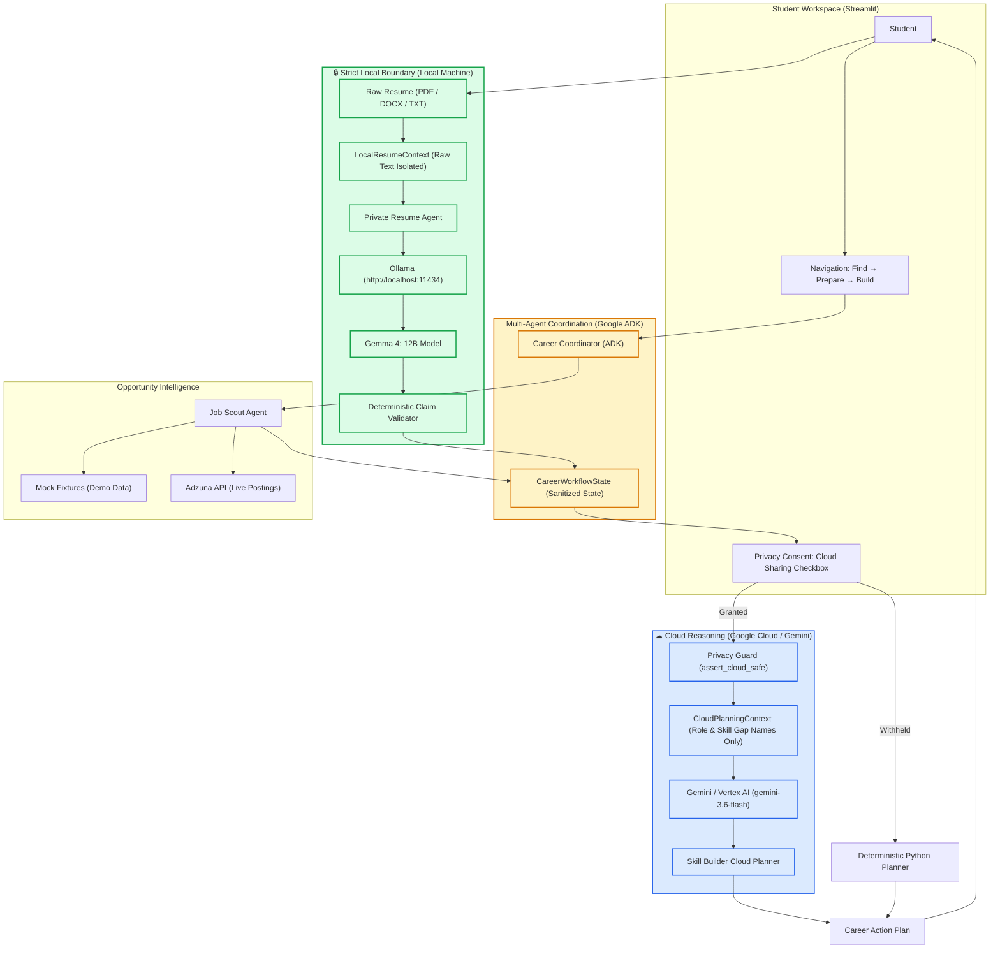

# Milestone 6 Demo Acceptance Report
**Milestone**: M6 — Hybrid Gemini + Gemma Privacy Routing Working Demo  
**Release Tag**: `v0.6.0`  
**Repository**: `https://github.com/hastimal/agentic-career-lab`  
**Date**: October 11, 2026  
**Status**: ACCEPTED (All Verification Steps Passed)  

---

## 1. Executive Summary

Milestone 6 integrates the hybrid model routing architecture:
1. **Local Privacy Boundary**: Private resume analysis and claim validation run strictly locally on user hardware using **Gemma 4** (`gemma4:12b`) through Ollama. Raw resume text is **never** transmitted to cloud models.
2. **Cloud AI Planning**: High-level learning roadmaps and portfolio project recommendations are synthesized via **Google Gemini** (`gemini-3.6-flash` / `gemini-3.8-flash`) using Google Cloud Vertex AI / Gemini API.
3. **Explicit User Consent**: Cloud sharing of sanitized skill gaps requires explicit user approval via the UI; when consent is withheld, execution falls back completely to local deterministic Python planning.
4. **Multi-Agent Coordination**: **Google ADK** orchestrates the sequence across Job Scout, Private Resume Agent, and Skill Builder to compile an actionable, evidence-backed Career Action Plan.

---

## 2. Architecture & Privacy Boundary Diagram



---

## 3. Evidence of Live Execution

### A. Local Ollama & Gemma 4 Smoke Test
**Command**:
```bash
.venv/bin/python scripts/smoke_resume_local.py scratch/sample_resume.txt
```
**Output**:
```text
========================================
LOCAL RESUME SMOKE TEST
========================================

Parser
✓ TXT parsed locally
Characters: 963

Ollama
✓ Connected

Model
✓ gemma4:12b

Resume Evidence

Target Role Mapping

Demonstrated:
- Python
- Docker

Partial:

Missing:
- Google Cloud
- Vertex AI
- Kubernetes

Suggestions: 0
Safety:
✓ No unsupported claims accepted

ADK coordinator:
✓ local resume path completed
Raw resume stored in CareerWorkflowState:
No

========================================
RESULT: PASS
========================================
```

### B. End-to-End Hybrid Workflow (Job Scout → Resume Agent → Skill Builder → Action Plan)
**Command**:
```bash
.venv/bin/python -c "
from dotenv import load_dotenv; load_dotenv()
from agentic_career_lab.runtime.factory import create_job_provider, create_resume_llm, create_skill_planner
from agentic_career_lab.agents.job_scout.agent import JobScoutAgent
from agentic_career_lab.agents.resume_agent.agent import PrivateResumeAgent
from agentic_career_lab.agents.skill_builder.agent import SkillBuilderAgent
from agentic_career_lab.coordinator.adk_coordinator import ADKCareerCoordinator
from agentic_career_lab.coordinator.career_coordinator import CareerCoordinator
from agentic_career_lab.coordinator.state import CareerAction, CareerWorkflowState, LocalResumeContext
from agentic_career_lab.models import StudentProfile, OpportunitySearchQuery

domain_coord = CareerCoordinator(
    job_scout=JobScoutAgent(provider=create_job_provider()),
    resume_agent=PrivateResumeAgent(llm=create_resume_llm()),
    skill_builder=SkillBuilderAgent(llm=create_skill_planner()),
)
adk_coord = ADKCareerCoordinator(domain_coord)
state = CareerWorkflowState(
    student_profile=StudentProfile(name='Alex', target_role='AI Engineer', education_level='Junior', major='CS', skills=['Python', 'Docker']),
    search_query=OpportunitySearchQuery(role='AI Engineer', location='Texas', internship_only=True, keywords=[])
)
state = adk_coord.execute_action(CareerAction.FIND_OPPORTUNITIES, state)
state.selected_opportunity = state.opportunities[0].opportunity
with open('scratch/sample_resume.txt') as f: text = f.read()
state = adk_coord.execute_action(CareerAction.PREPARE_RESUME, state, LocalResumeContext(raw_resume_text=text))
state = adk_coord.execute_action(CareerAction.BUILD_SKILLS, state)
plan = adk_coord.create_action_plan(state)
print('Status:', plan.workflow_status)
print('Target:', plan.target_opportunity.role)
print('Steps:', len(plan.learning_plan))
print('Project:', plan.portfolio_project.title if plan.portfolio_project else None)
"
```
**Output**:
```text
Status: Complete
Target: AI Engineering Intern
Steps: 4
Project: Cloud-Native AI Microservice Pipeline on GKE and Vertex AI
```

### C. Test Suite & Code Quality
```bash
.venv/bin/pytest -v
# Output: 53 passed, 1 warning in 0.69s

.venv/bin/ruff check .
# Output: All checks passed!

.venv/bin/ruff format --check .
# Output: 64 files already formatted
```

### D. Streamlit App Health
```bash
.venv/bin/streamlit run src/agentic_career_lab/app.py --server.headless true --server.port 8503 &
curl -s http://localhost:8503/_stcore/health
# Output: ok
```

---

## 4. Reproducible Startup Instructions

### Prerequisites
1. **Ollama**: Ensure Ollama is installed and running (`ollama serve`). Pull the Gemma 4 model:
   ```bash
   ollama pull gemma4:12b
   ```
2. **Python Environment**:
   ```bash
   python3 -m venv .venv
   source .venv/bin/activate
   pip install -e ".[dev]"
   ```
3. **Environment Setup**:
   ```bash
   cp .env.example .env
   # Add your GEMINI_API_KEY if testing live cloud reasoning.
   # (Without a key, system automatically falls back to deterministic Python).
   ```

### Running the Application
```bash
streamlit run src/agentic_career_lab/app.py
```
Open your browser at `http://localhost:8501`.

---

## 5. Acceptance Decision
**PASS / ACCEPTED**. Milestone 6 is complete and satisfies all functional, privacy, quality, and architectural requirements.
