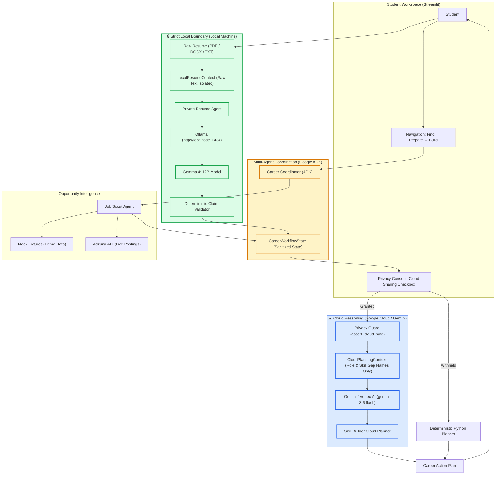

# Agentic Career Lab Architecture

## Overview

Agentic Career Lab is a privacy-aware hybrid multi-agent career platform designed specifically for college students seeking internships and early-career roles.

## Architectural Principles

1. **Privacy-First Resume Processing**:
   - Resumes contain personally identifiable information (PII) and student history.
   - All resume parsing, evidence extraction, and bullet point improvement occur **locally** via Gemma 4 running on Ollama (`http://localhost:11434`).
   - Raw resume text is **never** sent to cloud models.

2. **Evidence-Grounded Opportunity Intelligence**:
   - Job Scout uses Gemini on Vertex AI to extract explicit requirements from verifiable external opportunity sources.
   - Fabricated opportunities or missing source links are strictly rejected.

3. **Deterministic Business Logic**:
   - Matching requirements to extracted evidence is performed with deterministic Python comparison.
   - LLMs explain reasoning and synthesize learning roadmaps, rather than hallucinating arbitrary percentage match scores (e.g. 87% vs 92%).

4. **8-Milestone Incremental Delivery**:
   - Milestone 1: Foundation + Modern UI Shell
   - Milestone 2: Evidence-Backed Job Scout Agent
   - Milestone 3: Private Resume Agent with Gemma 4 + Ollama
   - Milestone 4: Opportunity-Driven Skill Builder Agent
   - Milestone 5: Google ADK Multi-Agent Coordinator (Complete)
   - Milestone 6: Hybrid Gemini + Gemma Privacy Routing (Complete)
   - Milestone 7: Docker + Cloud Run Deployment (Planned)
   - Milestone 8: Evaluation & Observability

6. **Simplified Student Flow**:
   - The user experience is simplified to three main steps:
     1. Find Opportunity
     2. Prepare Resume
     3. Build Missing Skills
   - Complexities are hidden, avoiding manual re-entry between steps.
   - Skill Builder deterministically identifies gaps (Python) and relies on LLMs solely for planning.

5. **Logging/Privacy UX Rule**:
   - Future Agent Activity logs must NEVER expose:
     - raw resume text
     - personally identifying information
     - private document content
   - Future logs may show:
     - agent name
     - tool name
     - model/runtime
     - status
     - sanitized summary
     - latency
     - result counts
     - failure state
