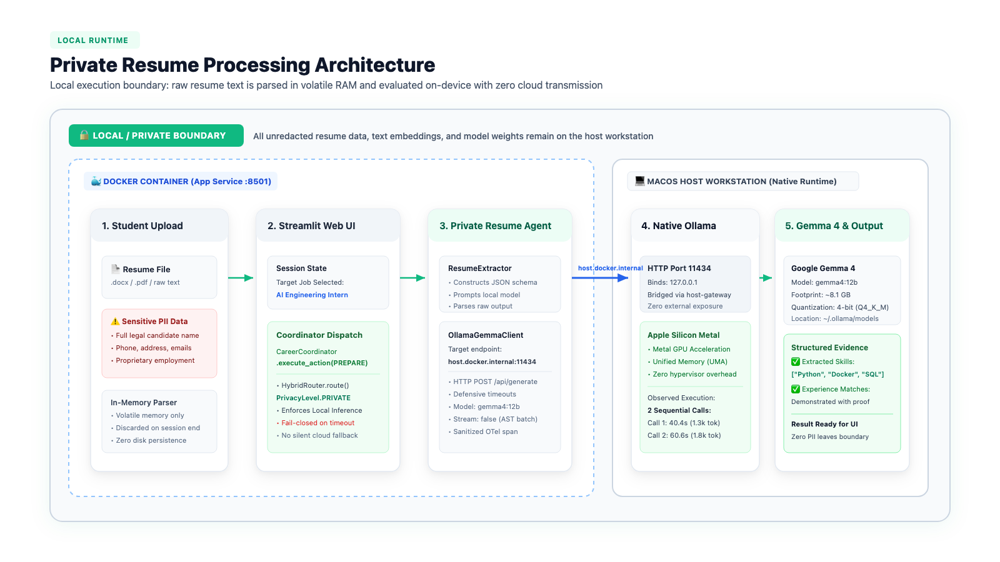
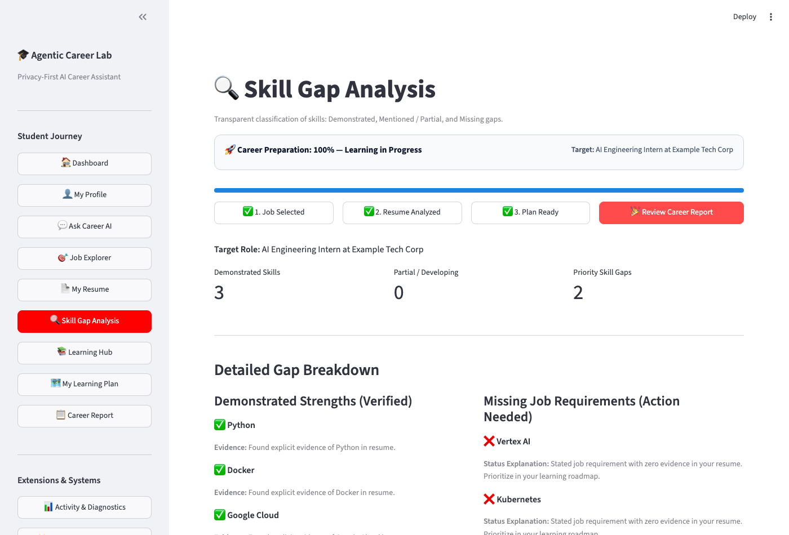
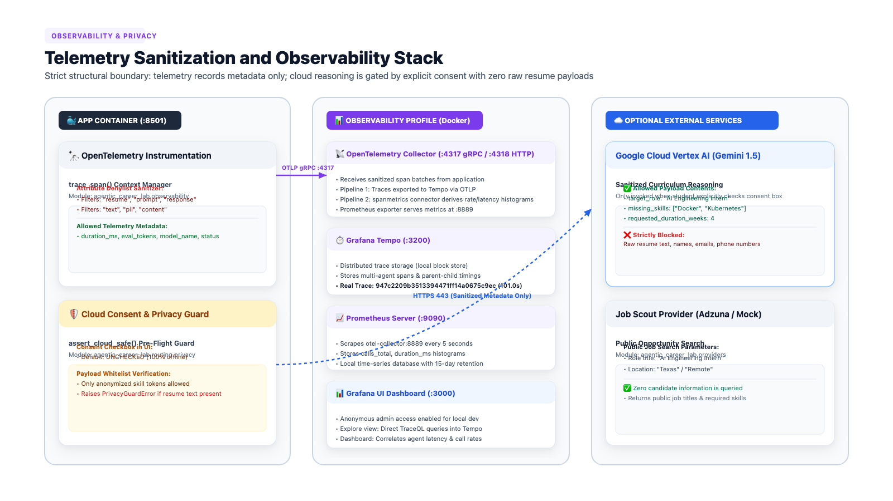
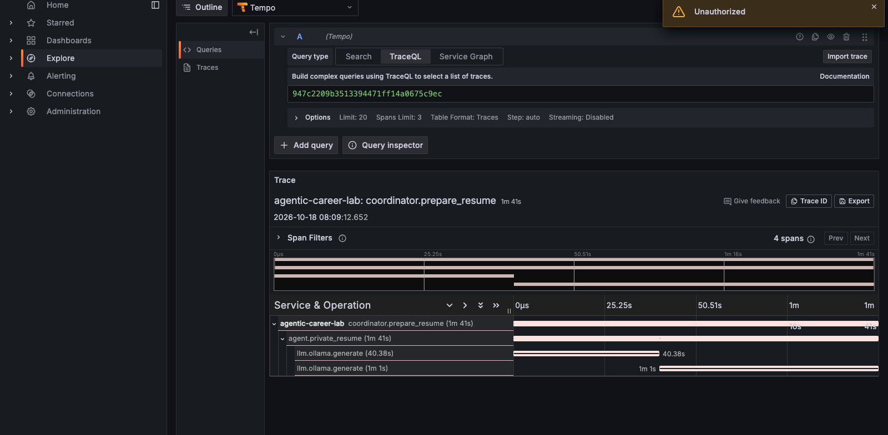

# Building a Private AI Resume Agent with Gemma 4, Ollama, and Docker

*How to architect, deploy, and trace privacy-first career intelligence on local hardware without sending sensitive candidate resumes to cloud models.*

---

## 1. The Engineering Challenge: Where Does the Resume Go?

Building an AI resume assistant sounds simple: upload a resume, call an LLM, and return a skills summary. But where does that resume go, and what happens when the application needs cloud services, logs, and distributed tracing?

In standard GenAI architectures, application code grabs the candidate's document, wraps it in a prompt template, and sends an HTTPS request to an external frontier model API (such as Google Cloud Vertex AI or OpenAI).

For generic text summarization or public web search, this cloud-first pipeline is standard. For career applications and resume analysis, it creates an immediate privacy and security problem.

A resume is not public web text. It is a dense, high-liability personal dossier containing:
- Candidate names, home addresses, phone numbers, and email addresses.
- Detailed employment histories, proprietary project names, and internal company details.
- Educational credentials, degree dates, and GPA markers.
- Inherent demographic proxies protected under global privacy regulations (GDPR, CCPA, EEOC).

When an application dispatches unredacted resumes to third-party model inference endpoints, organizations take on legal liability, cross-border data transfer risks, and third-party data retention concerns. Prompt engineering—such as instructing a remote model *"Please do not retain this personal information"*—provides zero architectural protection:

> **Privacy cannot depend on prompt instructions; privacy must be enforced by architecture.**

In this article, we examine how we solved this problem in [Agentic Career Lab](https://github.com/hastimal/agentic-career-lab). We examine how the system pairs Google's open **Gemma 4** model running locally in an **Ollama** runtime with a containerized multi-agent coordinator, strict schema-level data minimization, and sanitized **OpenTelemetry** distributed tracing.

---

## 2. Architecture: Keeping Resume Analysis Local

Instead of choosing between an entirely air-gapped system or an entirely cloud-dependent one, the application uses a hybrid multi-agent topology.

We partition tasks based on strict privacy classifications:
1. **Private Data (Local Only)**: Raw resume documents, parsed document ASTs, candidate identities, and semantic experience-matching remain strictly on the host via Gemma 4 and Ollama.
2. **Public Data (API Accessible)**: Real-time job opportunity queries and market aggregations route across public job providers (such as Adzuna or mock testing harnesses).
3. **Structured Metadata (Optional Cloud Reasoner)**: Learning plans and skill roadmap synthesis utilize cloud reasoning (e.g., Google Gemini 1.5 Flash on Vertex AI) **only** if explicit student consent is granted, and **only** using anonymized skill tokens (such as `["Docker", "PyTorch"]`). Raw resume text is structurally prevented from entering this payload.

### Private Resume Processing Architecture


*Figure 1: Private Resume Processing Architecture. Raw resume documents are parsed in volatile memory inside Docker and evaluated by native Ollama running Gemma 4 on the host machine.*

### Architectural Privacy Boundary

To make the boundary enforceable, every task maps to an explicit enum handled by the system's `HybridRouter`:

| Task Type | Sensitivity Level | Execution Runtime | Cloud Allowed? | Fallback Behavior |
| :--- | :--- | :--- | :---: | :--- |
| `RESUME_ANALYSIS` | **Private** | Gemma 4 / Ollama (Local) | ❌ **No** | Fail closed (`RuntimeError`); zero cloud fallback |
| `RESUME_REWRITE` | **Private** | Gemma 4 / Ollama (Local) | ❌ **No** | Fail closed; candidate data never leaves host |
| `SKILL_MATCHING` | **Structured** | Python AST / Skill Normalizer | ❌ **No** | Deterministic local string and taxonomy matching |
| `GAP_ANALYSIS` | **Structured** | Python Set Logic | ❌ **No** | Local calculation of missing job requirements |
| `OPPORTUNITY_SEARCH`| **Public** | Python / Mock / Adzuna HTTP | ✅ **Yes** | Retrieves public job postings |
| `LEARNING_PLAN` | **Structured** | Gemini Flash or Deterministic | ✅ *(With Consent)* | Falls back to local deterministic catalog if unconsented |

---

## 3. Running Gemma 4 with Ollama

Google's open-weights Gemma models provide strong reasoning, code comprehension, and instruction-following within footprints that run on commodity developer workstations.

For resume evidence extraction and claim validation, the **Gemma 4 12B** parameter variant (`gemma4:12b`) provides a practical balance between structural JSON compliance and local execution speed.

### Model Setup and Verification

To pull and verify Gemma 4 locally on your workstation:

```bash
# Verify Ollama service is running
ollama --version

# Pull the 12B parameter Gemma model
ollama pull gemma4:12b

# Verify the model is registered locally
ollama list
# NAME          ID           SIZE      MODIFIED
# gemma4:12b    a35b0d0e1f4b 8.1 GB    10 minutes ago

# Verify local inference directly from the CLI
ollama run gemma4:12b "Extract skills from: Experienced in Python, Docker, and Google Cloud."
```

### Why Native Ollama on Apple Silicon?

While Ollama can run inside a container, running Ollama **natively on the macOS host** is the recommended pattern for Apple Silicon (M1/M2/M3/M4) systems:
1. **Unified Memory Architecture (UMA)**: The native binary has direct access to unified system RAM.
2. **Apple Metal Acceleration**: Host-native Ollama utilizes macOS Metal Performance Shaders (`MPS`), allowing the GPU cores to accelerate inference.
3. **Docker VM Limitations**: Docker Desktop on macOS runs Linux inside a virtual machine hypervisor, which lacks direct passthrough to Apple Metal GPU cores, degrading local inference to CPU emulation.

In our architecture, the application container accesses native host Ollama through `http://host.docker.internal:11434`.

---

## 4. Implementing the Private Resume Agent

The privacy guarantee lives in the source code of the `PrivateResumeAgent` and its underlying `OllamaGemmaClient`.

### 1. The Local LLM Client

The client connects to Ollama's REST API over HTTP, wraps each call with OpenTelemetry tracing spans, and applies defensive timeouts:

```python
# Simplified excerpt based on src/agentic_career_lab/llm/local.py
import httpx
import os
from agentic_career_lab.observability import trace_span

class OllamaGemmaClient:
    def __init__(self, base_url: str = "http://localhost:11434", model_name: str = "gemma4:12b"):
        self.base_url = base_url.rstrip("/")
        self.model_name = model_name

    def generate(self, prompt: str) -> str:
        with trace_span(
            "llm.ollama.generate",
            agent_name="Private Resume Agent",
            model_name=self.model_name,
            runtime="Gemma 4 / Ollama",
            attributes={"prompt_length": len(prompt)},
        ) as span:
            timeouts = httpx.Timeout(
                connect=float(os.environ.get("OLLAMA_CONNECT_TIMEOUT", "10.0")),
                read=float(os.environ.get("OLLAMA_TIMEOUT", "180.0")),
                write=30.0,
                pool=10.0,
            )
            r = httpx.post(
                f"{self.base_url}/api/generate",
                json={"model": self.model_name, "prompt": prompt, "stream": False},
                timeout=timeouts,
            )
            r.raise_for_status()
            resp = r.json()
            if "eval_count" in resp:
                span.set_attribute("llm.eval_tokens", resp["eval_count"])
            return resp.get("response", "")
```

*Code Listing 1: [`src/agentic_career_lab/llm/local.py`](https://github.com/hastimal/agentic-career-lab/blob/main/src/agentic_career_lab/llm/local.py#L42-L78). The prompt length and token counts are exported to telemetry, but the raw text itself is never attached to the span.*

### 2. The Private Resume Agent Execution Policy

When processing a resume, the `PrivateResumeAgent` queries the `HybridRouter`. If Ollama is unreachable, it raises an exception rather than falling back to a cloud model:

```python
# Simplified excerpt based on src/agentic_career_lab/agents/resume_agent/agent.py
from agentic_career_lab.routing import HybridRouter, TaskType
from agentic_career_lab.models import Opportunity, ResumeAnalysis

class PrivateResumeAgent:
    def __init__(self, llm: LocalLLM):
        self.llm = llm
        self.extractor = ResumeExtractor(self.llm)
        self.mapper = RequirementMapper(SkillNormalizer())

    def run(self, resume_text: str, opportunity: Opportunity | None) -> ResumeAnalysis:
        route = HybridRouter.route(TaskType.RESUME_ANALYSIS)

        if not self.llm.is_available():
            raise RuntimeError(
                f"Ollama is not reachable at {self.llm.base_url}. Local model unavailable."
            )

        evidence = self.extractor.extract(resume_text)
        matches = self.mapper.map_requirements(opportunity.requirements, evidence) if opportunity else []

        return ResumeAnalysis(
            requirement_matches=matches,
            missing_evidence=[m.requirement for m in matches if m.status == "Missing"],
            safety_summary="Validation complete. Zero remote data transmission."
        )
```

*Code Listing 2: [`src/agentic_career_lab/agents/resume_agent/agent.py`](https://github.com/hastimal/agentic-career-lab/blob/main/src/agentic_career_lab/agents/resume_agent/agent.py#L22-L75). Hard architectural assertion ensuring unredacted resumes cannot leave local execution.*

---

## 5. Dockerizing the Application

To ensure reproducible deployment, the application is packaged as a Docker container running as an unprivileged non-root user (`appuser` with UID `10001`):

```dockerfile
# Simplified excerpt based on Dockerfile
FROM python:3.11-slim AS runtime

ENV PYTHONUNBUFFERED=1 PYTHONDONTWRITEBYTECODE=1 PORT=8501
WORKDIR /app

RUN apt-get update && apt-get install -y --no-install-recommends curl \
    && rm -rf /var/lib/apt/lists/* \
    && useradd -u 10001 -m -s /bin/bash appuser

COPY pyproject.toml README.md ./
RUN pip install --no-cache-dir .

COPY src/ ./src/
RUN chown -R appuser:appuser /app

USER appuser
EXPOSE 8501

HEALTHCHECK --interval=10s --timeout=5s --retries=3 \
    CMD curl -fsS http://localhost:8501/_stcore/health || exit 1

ENTRYPOINT ["streamlit", "run", "src/agentic_career_lab/app.py", "--server.port=8501", "--server.address=0.0.0.0"]
```

---

## 6. Real Application Demonstration

In the user interface, candidates upload resumes in `.pdf`, `.docx`, or `.txt` formats. The document is parsed in volatile session state without saving to persistent disk or sending to external APIs.


*Figure 2: The Streamlit My Resume view. Displays uploaded resume confirmation, local memory parsing, privacy notice, and local Gemma 4 evidence extraction triggers.*

When the user runs analysis, the local Gemma 4 model extracts structured skills and experience items, which are then compared against the selected target role requirements:


*Figure 3: Skill Gap Analysis view. Shows transparent three-category breakdown: Demonstrated Strengths (verified with resume evidence), Mentioned/Partial Skills, and Missing Requirements.*

---

## 7. Connecting Docker to Native Ollama & Observability Stack

The primary deployment pattern connects the containerized application to the native Ollama service running on the host workstation, while routing telemetry to a local observability stack.


*Figure 4: Observability and Privacy Architecture. OpenTelemetry spans are sanitized in-app, exported over OTLP gRPC to the Collector, and routed to Tempo and Prometheus. Optional cloud reasoning is gated by explicit user consent.*

### Docker Compose Configuration

The root `docker-compose.yml` configures service routing and Docker Compose profiles:

```yaml
# Excerpt from docker-compose.yml
services:
  app:
    build:
      context: .
      dockerfile: Dockerfile
    image: agentic-career-lab:latest
    container_name: agentic-career-lab-app
    ports:
      - "8501:8501"
    environment:
      - OLLAMA_BASE_URL=http://host.docker.internal:11434
      - GEMMA_MODEL=gemma4:12b
      - JOB_PROVIDER=mock
      - OTEL_EXPORTER_OTLP_ENDPOINT=http://otel-collector:4317
      - OTEL_EXPORTER_OTLP_PROTOCOL=grpc
    extra_hosts:
      - "host.docker.internal:host-gateway"
    restart: unless-stopped
    healthcheck:
      test: ["CMD-SHELL", "curl -fsS http://localhost:8501/_stcore/health || exit 1"]
      interval: 10s
      timeout: 5s
      retries: 3
```

### Running the Stack

To build and start the application along with OpenTelemetry Collector, Tempo, Prometheus, and Grafana:

```bash
# Start application and observability stack
docker compose --profile observability up -d --build

# Verify running services
docker compose --profile observability ps
```

The resulting services will be active:

| Service Name | Container Name | Local Port | Role |
| :--- | :--- | :--- | :--- |
| `app` | `agentic-career-lab-app` | `8501` | Streamlit Web Application & Multi-Agent Engine |
| `otel-collector`| `agentic-career-lab-otel-collector` | `4317` / `4318` | OpenTelemetry Collector (gRPC & HTTP OTLP) |
| `tempo` | `agentic-career-lab-tempo` | `3200` | Grafana Tempo Distributed Trace Storage |
| `prometheus` | `agentic-career-lab-prometheus` | `9090` | Time-Series Metrics Engine |
| `grafana` | `agentic-career-lab-grafana` | `3000` | Visual Observability & Trace Exploration UI |

---

## 8. Observability Without Leaking Private Data

Why do local AI agents need distributed tracing?

When working with local LLMs, debugging latency, tracking memory pressure, identifying model timeouts, and isolating failures is essential. A 12-billion parameter model may take 20–40 seconds on an Apple Silicon Mac with Metal acceleration, but significantly longer under high memory pressure or on CPU.

However, default OpenTelemetry auto-instrumentation often captures HTTP request bodies, headers, and function arguments. In a career application, that would leak candidate resumes directly into monitoring logs.

### Sanitized Tracing Implementation

`agentic_career_lab.observability` implements an attribute sanitizer that discards sensitive keys before span emission:

```python
# Simplified excerpt based on src/agentic_career_lab/observability.py
import time
from contextlib import contextmanager
from opentelemetry import trace
from opentelemetry.trace import Status, StatusCode

@contextmanager
def trace_span(
    name: str,
    attributes: dict[str, Any] | None = None,
    agent_name: str | None = None,
    model_name: str | None = None,
    runtime: str | None = None,
):
    tracer = get_tracer()
    attrs: dict[str, Any] = {}
    if agent_name:
        attrs["agent.name"] = agent_name
    if model_name:
        attrs["llm.model"] = model_name
    if runtime:
        attrs["llm.runtime"] = runtime

    if attributes:
        for k, v in attributes.items():
            k_lower = k.lower()
            if any(forbidden in k_lower for forbidden in (
                "resume", "text", "prompt", "response", "pii", "content"
            )):
                continue
            if isinstance(v, (str, int, float, bool)):
                attrs[k] = v

    start_time = time.time()
    with tracer.start_as_current_span(name, attributes=attrs) as span:
        try:
            yield span
            span.set_attribute("workflow.duration_ms", (time.time() - start_time) * 1000)
            span.set_status(Status(StatusCode.OK))
        except Exception as exc:
            span.set_attribute("workflow.duration_ms", (time.time() - start_time) * 1000)
            span.set_attribute("error.type", type(exc).__name__)
            span.set_attribute("error.message", str(exc)[:200])
            span.record_exception(exc)
            span.set_status(Status(StatusCode.ERROR, str(exc)))
            raise
```

*Code Listing 3: [`src/agentic_career_lab/observability.py`](https://github.com/hastimal/agentic-career-lab/blob/main/src/agentic_career_lab/observability.py#L125-L175). Denylist filtering discards attribute keys containing `resume`, `prompt`, `response`, or `pii` before span creation.*

---

## 9. A Real Resume-Analysis Trace

To demonstrate execution visibility, we inspect a real trace captured during end-to-end resume preparation.

### Grafana Tempo Trace Waterfall

Opening Grafana at `http://localhost:3000` and navigating to **Explore → Tempo** reveals the complete span hierarchy:


*Figure 5: Grafana Tempo trace waterfall for `coordinator.prepare_resume` (Trace ID `947c2209b3513394471ff14a0675c9ec`). Illustrates the four-span hierarchy across the coordinator, private resume agent, and two distinct Ollama inference calls.*

### Anatomy of the Four-Span Waterfall

The trace hierarchy illustrates the exact execution path:

```
coordinator.prepare_resume                               [101.0s / 101,017 ms]
  └── agent.private_resume                               [101.0s / 101,016 ms]
        ├── llm.ollama.generate (Evidence Extraction)    [ 40.4s /  40,384 ms]
        └── llm.ollama.generate (Resume Suggestions)     [ 60.6s /  60,610 ms]
```

1. **Root Span (`coordinator.prepare_resume`)**: Initiated by the `CareerCoordinator` when the user clicks **Analyze Resume Privately**. Total duration: 101.0 seconds (101,017 ms).
2. **Child Span (`agent.private_resume`)**: The `PrivateResumeAgent` executing the privacy-gated workflow. Total duration: 101.0 seconds (101,016 ms).
3. **First Leaf Span (`llm.ollama.generate`)**: The first HTTP POST request to Ollama's `/api/generate` endpoint for structured JSON evidence extraction. Duration: 40.4 seconds (40,384 ms; prompt eval: 150 tokens, generation: 1,316 tokens).
4. **Second Leaf Span (`llm.ollama.generate`)**: The second sequential HTTP POST request to Ollama for targeted resume improvement suggestions. Duration: 60.6 seconds (60,610 ms; prompt eval: 25 tokens, generation: 1,771 tokens).

### What Telemetry Stores vs. What It Discards

Inspecting the span tags confirms the privacy behavior:

| Span Attribute | Recorded Value | Privacy Status |
| :--- | :--- | :--- |
| `service.name` | `agentic-career-lab` | ✅ Recorded |
| `agent.name` | `Private Resume Agent` | ✅ Recorded |
| `llm.model` | `gemma4:12b` | ✅ Recorded |
| `workflow.duration_ms` | `40384.2` / `60610.1` | ✅ Recorded |
| `prompt_length` | `1428` (character count only) | ✅ Recorded |
| `llm.eval_tokens` | `1316` / `1771` (token count) | ✅ Recorded |
| `raw_resume_text` | *(None - Filtered)* | 🔒 **Sanitized** |
| `prompt` | *(None - Filtered)* | 🔒 **Sanitized** |
| `candidate_name` | *(None - Filtered)* | 🔒 **Sanitized** |

---

## 10. Testing the Privacy Boundary

Automated tests verify routing, schema hygiene, and span sanitization.

### Automated Test Coverage

The test suite runs with `pytest`:

```bash
uv run pytest
# ================= 113 passed in 1.76s =================
```

### 1. Synthetic Secret Marker Verification

`tests/test_evaluation_observability.py` injects a synthetic secret marker and phone number into a candidate's resume, runs the full coordinator workflow, and iterates through every captured OpenTelemetry span:

```python
# Simplified excerpt based on tests/test_evaluation_observability.py
def test_opentelemetry_tracing_and_privacy_boundary():
    coord = get_test_coordinator()
    secret_marker = "SUPER_SECRET_PII_AND_RAW_RESUME_MARKER_12345"
    resume_text = f"Candidate Name\nPhone: 555-0199\nSkills: Python, Docker.\n{secret_marker}"
    local_ctx = LocalResumeContext(raw_resume_text=resume_text)

    # Execute coordinator actions
    state = coord.execute_action(CareerAction.PREPARE_RESUME, state, local_resume=local_ctx)

    spans = get_in_memory_spans()

    # Assert secret marker and phone number NEVER appear in any span attribute or status
    for span in spans:
        if span.attributes:
            for k, v in span.attributes.items():
                assert secret_marker not in str(v), f"Leaked secret in attribute {k}"
                assert "555-0199" not in str(v), f"Leaked phone in attribute {k}"
        if span.status.description:
            assert secret_marker not in span.status.description
```

### 2. Cloud Payload Schema Verification

`tests/test_routing.py` verifies that the data model sent to cloud reasoning engines (`CloudPlanningContext`) physically omits raw resume fields:

```python
# Simplified excerpt based on tests/test_routing.py
def test_cloud_planning_context_strictly_excludes_raw_resume():
    ctx = CloudPlanningContext(
        target_role="AI Engineer",
        required_skills=["Python", "Docker"],
        demonstrated_skills=["Python"],
        missing_skills=["Docker"],
        plan_duration_weeks=4,
    )
    dumped = ctx.model_dump()
    assert "raw_resume_text" not in dumped
    assert "resume_text" not in dumped
    assert "email" not in dumped
    assert "phone" not in dumped
    assert_cloud_safe(ctx)
```

If code attempts to add a `raw_resume_text` key to a cloud payload, `assert_cloud_safe()` raises `PrivacyGuardError` before any HTTP connection can be established.

---

## 11. Reproducing the Demo

To run this application locally, choose between two deployment pathways:

### Option A: UVX Quickstart (Simplest)

If you have Python 3.11+ and `uv` installed, launch the application directly:

```bash
# Ensure Ollama is running and has Gemma 4
ollama pull gemma4:12b

# Launch directly via uvx
uvx agentic-career-lab
```

Open `http://localhost:8501` to begin.

### Option B: Docker Compose with Full Observability (Recommended)

To run the complete topology with Tempo, Prometheus, and Grafana:

```bash
# 1. Clone the repository
git clone https://github.com/hastimal/agentic-career-lab.git
cd agentic-career-lab

# 2. Ensure Ollama is running on your host machine
ollama pull gemma4:12b

# 3. Spin up the container stack
docker compose --profile observability up -d --build

# 4. Verify running services
docker compose --profile observability ps
```

Visit the services:
- **Streamlit Application**: [http://localhost:8501](http://localhost:8501)
- **Grafana Observability Dashboard**: [http://localhost:3000](http://localhost:3000)
- **Prometheus Metrics**: [http://localhost:9090](http://localhost:9090)
- **Tempo HTTP API**: [http://localhost:3200](http://localhost:3200)

---

## 12. Engineering Lessons and Limitations

Building private AI agent architectures yields distinct engineering tradeoffs:

### 1. Model Latency Dominates Execution
As demonstrated in the Tempo trace waterfall, model inference accounts for >99% of total workflow duration (101.0 seconds total; 40.4s for extraction, 60.6s for rewrite suggestions). Python coordinator overhead is negligible (<10 ms). When choosing local LLMs, latency depends heavily on client hardware capabilities.

### 2. Local Processing Does Not Automatically Mean Zero Retention
Running a model locally does not guarantee privacy if logging or exception formatting is careless. If an engineer enables debug logs that print full prompts (`logger.debug(f"Prompt: {prompt}")`), raw resume text is written to disk in plain text.

### 3. OpenTelemetry Exception Vectors Require Careful Sanitization
While attribute key denylists protect custom attributes, unhandled exceptions can leak sensitive data into telemetry. When `span.record_exception(exc)` records a Python exception, any prompt or resume text embedded in `str(exc)` or the stacktrace will be attached to the span event. In production systems, exceptions must be sanitized before recording.

### 4. Consent-Driven Cloud Augmentation
Local models excel at extraction and structured classification, while complex multi-week curriculum synthesis benefits from larger models. By decoupling local extraction from cloud synthesis via allowlisted metadata tokens, developers can leverage both paradigms without transmitting raw candidate documents.

---

## 13. GitHub Repository and Resources

All source code, configuration files, and test suites are open source and available on GitHub:

- **GitHub Repository**: [https://github.com/hastimal/agentic-career-lab](https://github.com/hastimal/agentic-career-lab)
- **Core Agent Code**: [`src/agentic_career_lab/agents/resume_agent/`](https://github.com/hastimal/agentic-career-lab/tree/main/src/agentic_career_lab/agents/resume_agent)
- **Observability Configuration**: [`monitoring/`](https://github.com/hastimal/agentic-career-lab/tree/main/monitoring)
- **Architecture Documentation**: [`docs/architecture.md`](https://github.com/hastimal/agentic-career-lab/blob/main/docs/architecture.md)
