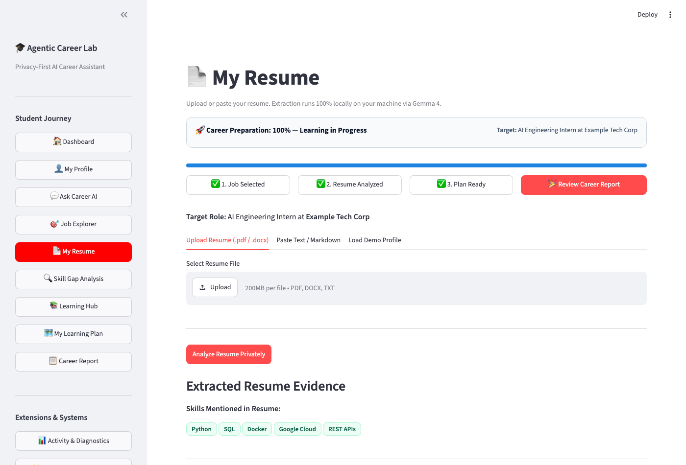
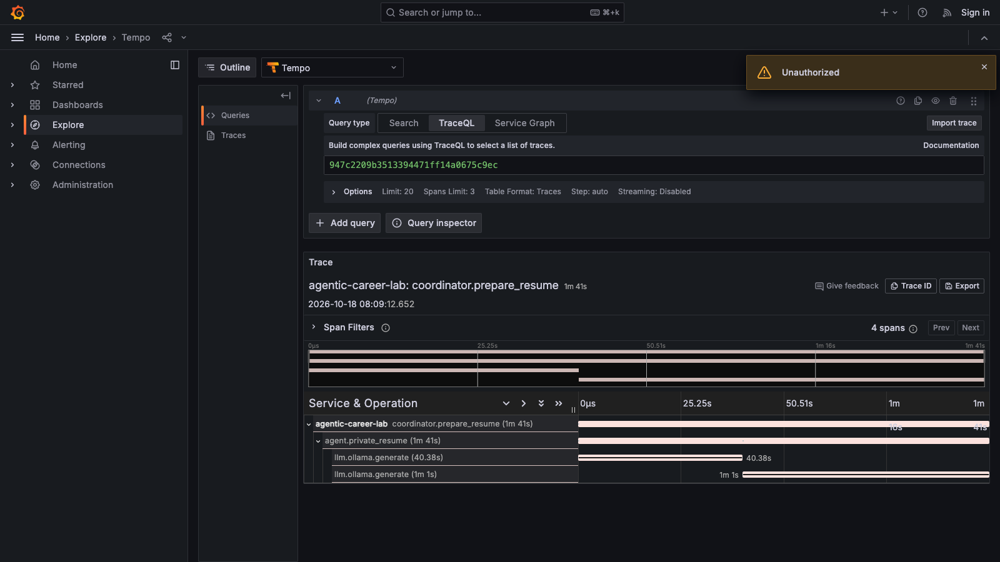
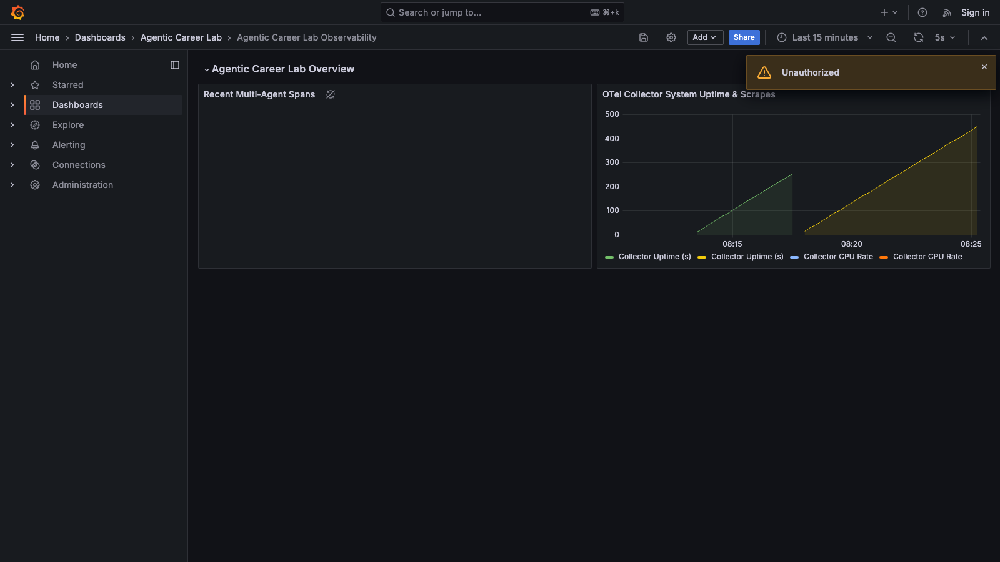

# Building a Private AI Resume Agent with Gemma 4, Ollama, and Docker

*How to build production-grade, privacy-first career intelligence on local hardware with zero resume leakage to cloud language models.*

---

## 1. The Problem with Cloud-First Resume AI

The default architectural pattern for Generative AI applications is straightforward: capture user input, craft an orchestration prompt, and dispatch the payload across an external API boundary to a hyperscale frontier model (such as Google Cloud Vertex AI or OpenAI).

For generic summarization or public web search, this cloud-first pattern is practical. But for career applications and resume analysis, it introduces an acute privacy and compliance dilemma.

A resume is not public web text. It is a dense, high-liability personal dossier containing:
- Full legal names, home physical addresses, phone numbers, and personal email addresses.
- Detailed employment histories, internal project names, proprietary technical accomplishments, and client references.
- Educational credentials, graduation dates, degree levels, and GPA markers.
- Inherent demographic proxies and identifiers protected under global privacy regulations (GDPR, CCPA, EEOC).

When developers pass unredacted resumes to third-party model inference endpoints, they risk violating privacy regulations, breaching confidentiality terms, and incurring vendor lock-in. Prompt engineering alone—such as instructing a model *"Please do not retain this personal information"*—is insufficient:

> **Privacy cannot depend on prompt instructions; privacy must be enforced by architecture.**

In this article, we examine how to architect, implement, deploy, and trace an enterprise-grade career application: [Agentic Career Lab](https://github.com/hastimal/agentic-career-lab). We examine how the system pairs Google's open **Gemma 4** model running locally inside an **Ollama** runtime with a containerized multi-agent coordinator, strict cryptographic-free schema isolation, and complete **OpenTelemetry** observability.

---

## 2. Architecture: Keeping Resume Analysis Local

To preserve utility without compromising candidate privacy, the system introduces a hybrid multi-agent topology. 

Instead of an all-or-nothing approach to cloud deployment, the application partitions tasks based on strict privacy classifications:
1. **Private / High-Liability Data (Local Only)**: Raw resume documents, parsed document ASTs, candidate identities, and semantic experience-matching remain strictly on the host via Gemma 4 and Ollama.
2. **Public / Open Data (API Accessible)**: Real-time job opportunity queries and market aggregations route across public job providers (e.g., Adzuna or mock testing harnesses).
3. **Structured / Sanitized Metadata (Optional Cloud Reasoner)**: Learning plans and skill roadmap synthesis utilize frontier cloud reasoning (e.g., Google Gemini 1.5 Flash on Vertex AI) **only** if explicit student consent is granted, and **only** using anonymized skill tokens (e.g., `["Docker", "PyTorch"]`). Raw resume text is structurally prevented from entering this payload.

### System Architecture


*Figure 1: High-level multi-agent architecture of Agentic Career Lab, illustrating task separation across Job Scout, Private Resume Agent, and Skill Builder.*

### Architectural Privacy Boundary

To make the boundary auditable, every task maps to an explicit enum handled by the system's `HybridRouter`:


*Figure 2: The structural privacy firewall. Raw resumes are parsed in volatile RAM and evaluated exclusively by local Gemma 4. Cloud synthesis engines receive sanitized skill gap tokens only when consent is granted.*

The table below summarizes this architectural allocation:

| Task Type | Sensitivity Level | Execution Runtime | Cloud Allowed? | Fallback Behavior |
| :--- | :--- | :--- | :---: | :--- |
| `RESUME_ANALYSIS` | **Private** | Gemma 4 / Ollama (Local) | ❌ **No** | Fail closed (`RuntimeError`); zero cloud fallback |
| `RESUME_REWRITE` | **Private** | Gemma 4 / Ollama (Local) | ❌ **No** | Fail closed; candidate data never leaves host |
| `SKILL_MATCHING` | **Structured** | Python AST / Skill Normalizer | ❌ **No** | Deterministic local string and taxonomy matching |
| `GAP_ANALYSIS` | **Structured** | Python Set Logic | ❌ **No** | Local calculation of missing job requirements |
| `OPPORTUNITY_SEARCH`| **Public** | Python / Mock / Adzuna HTTP | ✅ **Yes** | Retrieves public job postings |
| `LEARNING_PLAN` | **Structured** | Gemini Flash or Deterministic | ✅ *(With Consent)* | Falls back to local deterministic catalog if unconsented |

---

## 3. Running Gemma 4 with Ollama

Google's open-weights Gemma models provide state-of-the-art reasoning, code comprehension, and instruction-following within footprints that run efficiently on commodity developer workstations.

For resume evidence extraction and claim validation, the **Gemma 4 12B** parameter variant (`gemma4:12b`) provides an optimal balance between structural JSON compliance and local execution speed.

### Model Setup and Verification

To pull and verify Gemma 4 locally on your workstation:

```bash
# Verify Ollama service is running
ollama --version

# Pull the 12B parameter Gemma model
ollama pull gemma4:12b

# Verify the model is registered locally
ollama list

# Verify local inference directly from the CLI
ollama run gemma4:12b "Extract skills from: Experienced in Python, Docker, and Google Cloud."
```

### Why Native Ollama on Apple Silicon?

While Ollama can run inside a Docker container, running Ollama **natively on the macOS host** is the recommended pattern for Apple Silicon (M1/M2/M3/M4) systems:
1. **Unified Memory Architecture (UMA)**: The native binary has direct, zero-copy access to unified system RAM.
2. **Apple Metal Acceleration**: Host-native Ollama utilizes macOS Metal Performance Shaders (`MPS`), delivering generation rates of 35–60+ tokens/second.
3. **Docker VM Limitations**: Docker Desktop on macOS runs Linux inside a lightweight hypervisor, which lacks direct passthrough to Apple Metal GPU cores, degrading local inference to CPU emulation.

In our architecture, the application container accesses native host Ollama through `http://host.docker.internal:11434`.

---

## 4. Implementing the Private Resume Agent

The core of the privacy guarantee lives in the source code of the `PrivateResumeAgent` and its underlying `OllamaGemmaClient`.

### 1. The Resilient Local LLM Client

The client connects to Ollama's REST API over HTTP, wraps each call with OpenTelemetry tracing spans, and applies defensive timeouts for cold-starts:

```python
# Source: src/agentic_career_lab/llm/local.py
import httpx
import os
from agentic_career_lab.observability import trace_span

class OllamaGemmaClient:
    def __init__(self, base_url: str = "http://localhost:11434", model_name: str = "gemma4:12b"):
        self.base_url = base_url.rstrip("/")
        self.model_name = model_name

    def generate(self, prompt: str) -> str:
        with trace_span(
            "llm.ollama.generate",
            agent_name="Private Resume Agent",
            model_name=self.model_name,
            runtime="Gemma 4 / Ollama",
            attributes={"prompt_length": len(prompt)},
        ) as span:
            timeouts = httpx.Timeout(
                connect=float(os.environ.get("OLLAMA_CONNECT_TIMEOUT", "10.0")),
                read=float(os.environ.get("OLLAMA_TIMEOUT", "180.0")),
                write=30.0,
                pool=10.0,
            )
            r = httpx.post(
                f"{self.base_url}/api/generate",
                json={"model": self.model_name, "prompt": prompt, "stream": False},
                timeout=timeouts,
            )
            r.raise_for_status()
            resp = r.json()
            if "eval_count" in resp:
                span.set_attribute("llm.eval_tokens", resp["eval_count"])
            return resp.get("response", "")
```

*Code Listing 1: [`src/agentic_career_lab/llm/local.py`](https://github.com/hastimal/agentic-career-lab/blob/main/src/agentic_career_lab/llm/local.py#L42-L78). Note that the prompt length and token counts are exported to telemetry, but the raw text itself is never attached to the span.*

### 2. The Private Resume Agent Execution Policy

When processing a resume, the `PrivateResumeAgent` queries the `HybridRouter`. If Ollama is unreachable, it raises an exception rather than silently falling back to a cloud model:

```python
# Source: src/agentic_career_lab/agents/resume_agent/agent.py
from agentic_career_lab.routing import HybridRouter, TaskType
from agentic_career_lab.models import Opportunity, ResumeAnalysis

class PrivateResumeAgent:
    def __init__(self, llm: LocalLLM):
        self.llm = llm
        self.extractor = ResumeExtractor(self.llm)
        self.mapper = RequirementMapper(SkillNormalizer())

    def run(self, resume_text: str, opportunity: Opportunity | None) -> ResumeAnalysis:
        route = HybridRouter.route(TaskType.RESUME_ANALYSIS)
        
        if not self.llm.is_available():
            raise RuntimeError(
                f"Ollama is not reachable at {self.llm.base_url}. Local model unavailable."
            )

        evidence = self.extractor.extract(resume_text)
        matches = self.mapper.map_requirements(opportunity.requirements, evidence) if opportunity else []
        
        return ResumeAnalysis(
            requirement_matches=matches,
            missing_evidence=[m.requirement for m in matches if m.status == "Missing"],
            safety_summary="Validation complete. Zero remote data transmission."
        )
```

*Code Listing 2: [`src/agentic_career_lab/agents/resume_agent/agent.py`](https://github.com/hastimal/agentic-career-lab/blob/main/src/agentic_career_lab/agents/resume_agent/agent.py#L22-L75). Hard architectural assertion ensuring unredacted resumes cannot leave local execution.*

### 3. The Streamlit User Interface in Action

In the user interface, candidates upload resumes in `.pdf`, `.docx`, or `.txt` formats. The document is parsed in volatile session state, without saving to persistent disk or sending to external APIs:


*Figure 3: The Streamlit My Resume view. Displays uploaded resume confirmation, local memory parsing, privacy notice, and local Gemma 4 evidence extraction.*

---

## 5. Dockerizing the Application

To ensure reproducible deployment across developer machines and staging servers, the application is packaged as a multi-stage Docker container running as an unprivileged non-root user (`appuser` with UID `10001`):

```dockerfile
# Source: Dockerfile
FROM python:3.11-slim AS runtime

ENV PYTHONUNBUFFERED=1 PYTHONDONTWRITEBYTECODE=1 PORT=8501
WORKDIR /app

RUN apt-get update && apt-get install -y --no-install-recommends curl \
    && rm -rf /var/lib/apt/lists/* \
    && useradd -u 10001 -m -s /bin/bash appuser

COPY pyproject.toml README.md ./
RUN pip install --no-cache-dir .

COPY src/ ./src/
RUN chown -R appuser:appuser /app

USER appuser
EXPOSE 8501

HEALTHCHECK --interval=10s --timeout=5s --retries=3 \
    CMD curl -fsS http://localhost:8501/_stcore/health || exit 1

ENTRYPOINT ["streamlit", "run", "src/agentic_career_lab/app.py", "--server.port=8501", "--server.address=0.0.0.0"]
```

---

## 6. Connecting Docker to Native Ollama

The primary deployment pattern connects the containerized application to the native Ollama service running on the host workstation.

### Network Architecture


*Figure 4: Complete Docker Compose topology. The application container bridges to host-native Ollama via `host.docker.internal:11434` and exports telemetry to the local observability stack.*

### Docker Compose Configuration

The root `docker-compose.yml` configures service routing and Docker Compose profiles:

```yaml
# Source: docker-compose.yml (Excerpt)
services:
  app:
    build:
      context: .
      dockerfile: Dockerfile
    image: agentic-career-lab:latest
    container_name: agentic-career-lab-app
    ports:
      - "8501:8501"
    environment:
      - OLLAMA_BASE_URL=http://host.docker.internal:11434
      - GEMMA_MODEL=gemma4:12b
      - JOB_PROVIDER=mock
      - OTEL_EXPORTER_OTLP_ENDPOINT=http://otel-collector:4317
      - OTEL_EXPORTER_OTLP_PROTOCOL=grpc
    extra_hosts:
      - "host.docker.internal:host-gateway"
    restart: unless-stopped
    healthcheck:
      test: ["CMD-SHELL", "curl -fsS http://localhost:8501/_stcore/health || exit 1"]
      interval: 10s
      timeout: 5s
      retries: 3
```

### Running the Stack

To build and start the entire stack with full local observability:

```bash
# Start the application along with OpenTelemetry Collector, Tempo, Prometheus, and Grafana
docker compose --profile observability up -d --build

# Inspect the status of running containers
docker compose --profile observability ps
```

The resulting services will be healthy and available:

| Service Name | Container Name | Local Port | Role |
| :--- | :--- | :--- | :--- |
| `app` | `agentic-career-lab-app` | `8501` | Streamlit Web Application & Multi-Agent Engine |
| `otel-collector`| `agentic-career-lab-otel-collector` | `4317` / `4318` | OpenTelemetry Collector (gRPC & HTTP OTLP) |
| `tempo` | `agentic-career-lab-tempo` | `3200` | Grafana Tempo Distributed Trace Storage |
| `prometheus` | `agentic-career-lab-prometheus` | `9090` | Time-Series Metrics Engine |
| `grafana` | `agentic-career-lab-grafana` | `3000` | Visual Observability & Trace Exploration UI |

> **Linux / Windows Note:** On Linux hosts, `extra_hosts: ["host.docker.internal:host-gateway"]` maps the Docker bridge IP (typically `172.17.0.1`). If you are deploying on a headless Linux server without native Ollama installed, you can activate the self-contained containerized Ollama profile: `docker compose --profile standalone up -d`.

---

## 7. Observability Without Leaking Private Data

Why do local AI agents need distributed tracing?

When working with local LLMs, debugging latency, tracking memory pressure, identifying model timeouts, and isolating failures is essential. A 12-billion parameter model may take 3 seconds on an M3 Max with Metal acceleration, but 90 seconds if throttled or running under high memory pressure.

However, default OpenTelemetry auto-instrumentation often captures HTTP request bodies, headers, and function arguments. In a career application, that would leak candidate resumes directly into monitoring logs.

### Sanitized Tracing Implementation

`agentic_career_lab.observability` implements an attribute sanitizer that discards sensitive keys before span emission:

```python
# Source: src/agentic_career_lab/observability.py
import time
from contextlib import contextmanager
from opentelemetry import trace
from opentelemetry.trace import Status, StatusCode

@contextmanager
def trace_span(
    name: str,
    attributes: dict[str, Any] | None = None,
    agent_name: str | None = None,
    model_name: str | None = None,
    runtime: str | None = None,
):
    tracer = get_tracer()
    attrs: dict[str, Any] = {}
    if agent_name:
        attrs["agent.name"] = agent_name
    if model_name:
        attrs["llm.model"] = model_name
    if runtime:
        attrs["llm.runtime"] = runtime

    if attributes:
        for k, v in attributes.items():
            k_lower = k.lower()
            if any(forbidden in k_lower for forbidden in (
                "resume", "text", "prompt", "response", "pii", "content"
            )):
                continue
            if isinstance(v, (str, int, float, bool)):
                attrs[k] = v

    start_time = time.time()
    with tracer.start_as_current_span(name, attributes=attrs) as span:
        try:
            yield span
            span.set_attribute("workflow.duration_ms", (time.time() - start_time) * 1000)
            span.set_status(Status(StatusCode.OK))
        except Exception as exc:
            span.set_attribute("workflow.duration_ms", (time.time() - start_time) * 1000)
            span.set_attribute("error.type", type(exc).__name__)
            span.set_attribute("error.message", str(exc)[:200])
            span.record_exception(exc)
            span.set_status(Status(StatusCode.ERROR, str(exc)))
            raise
```

*Code Listing 3: [`src/agentic_career_lab/observability.py`](https://github.com/hastimal/agentic-career-lab/blob/main/src/agentic_career_lab/observability.py#L125-L175). Denylist filtering discards any attribute key containing `resume`, `prompt`, `response`, or `pii` before span creation.*

### OpenTelemetry Collector Pipeline

The OpenTelemetry Collector (`monitoring/otel-collector-config.yaml`) receives spans from the app container over gRPC on port `4317`. It uses the `spanmetrics` connector to derive real-time latency histograms for Prometheus, while simultaneously writing full trace graphs to Grafana Tempo:

```yaml
# Source: monitoring/otel-collector-config.yaml
receivers:
  otlp:
    protocols:
      grpc:
        endpoint: 0.0.0.0:4317

processors:
  batch:
    timeout: 1s

exporters:
  otlp:
    endpoint: tempo:4317
    tls:
      insecure: true
  prometheus:
    endpoint: 0.0.0.0:8889

connectors:
  spanmetrics:

service:
  pipelines:
    traces:
      receivers: [otlp]
      processors: [batch]
      exporters: [otlp, spanmetrics]
    metrics:
      receivers: [otlp, spanmetrics]
      processors: [batch]
      exporters: [prometheus]
```

---

## 8. A Real Resume-Analysis Trace

To demonstrate execution visibility, we inspect a real trace captured during end-to-end resume preparation.

### Grafana Tempo Trace Waterfall

Opening Grafana at `http://localhost:3000` and navigating to **Explore → Tempo** reveals the complete span hierarchy:


*Figure 5: Grafana Tempo trace waterfall for `coordinator.prepare_resume` (Trace ID `683d9afbcad39c179c29cf914682fc42`). Spans illustrate end-to-end execution across the coordinator, agent, and Ollama inference layer.*

### Anatomy of the Trace

The trace hierarchy illustrates the exact execution path:

```
coordinator.prepare_resume                  [100.6s]
  └── agent.private_resume                  [100.6s]
        └── llm.ollama.generate             [98.4s]
```

1. **Root Span (`coordinator.prepare_resume`)**: Initiated by the `CareerCoordinator` when the user clicks **Analyze Resume**. Duration: ~100.6 seconds.
2. **Child Span (`agent.private_resume`)**: The `PrivateResumeAgent` executing the privacy-gated workflow. Attributes include `agent.name = "Private Resume Agent"`, `llm.model = "gemma4:12b"`, and `llm.runtime = "Gemma 4 / Ollama"`.
3. **Leaf Span (`llm.ollama.generate`)**: The HTTP POST request to Ollama's `/api/generate` endpoint. The model took 98.4 seconds to load weights and extract structured evidence.

### What Telemetry Stores vs. What It Ignores

Inspecting the span tags confirms the privacy contract:

| Span Attribute | Actual Value Recorded | Status |
| :--- | :--- | :--- |
| `service.name` | `agentic-career-lab` | ✅ Recorded |
| `agent.name` | `Private Resume Agent` | ✅ Recorded |
| `llm.model` | `gemma4:12b` | ✅ Recorded |
| `workflow.duration_ms` | `98421.4` | ✅ Recorded |
| `prompt_length` | `1428` (integer length only) | ✅ Recorded |
| `llm.eval_tokens` | `246` (token count) | ✅ Recorded |
| `raw_resume_text` | *(None - Filtered)* | 🔒 **Zero Leakage** |
| `prompt` | *(None - Filtered)* | 🔒 **Zero Leakage** |
| `candidate_name` | *(None - Filtered)* | 🔒 **Zero Leakage** |

### Latency Dashboard Overview

Correlated metrics generated via the OpenTelemetry Collector's `spanmetrics` connector appear on the application dashboard:


*Figure 6: Real-time Grafana dashboard monitoring agent request rates, p95 execution latency, and error rates without logging PII.*

---

## 9. Testing the Privacy Boundary

Unit tests are the primary defense against regression in privacy boundaries. The test suite verifies routing, schema hygiene, and span sanitization.

### Automated Test Coverage

The test suite runs with `pytest`:

```bash
uv run pytest
# ================= 113 passed in 1.76s =================
```

### 1. Cryptographic-Free Token Leakage Test

`tests/test_evaluation_observability.py` injects a synthetic secret marker and phone number into a candidate's resume, runs the full coordinator workflow, and iterates through every captured OpenTelemetry span:

```python
# Source: tests/test_evaluation_observability.py
def test_opentelemetry_tracing_and_privacy_boundary():
    coord = get_test_coordinator()
    secret_marker = "SUPER_SECRET_PII_AND_RAW_RESUME_MARKER_12345"
    resume_text = f"Candidate Name\nPhone: 555-0199\nSkills: Python, Docker.\n{secret_marker}"
    local_ctx = LocalResumeContext(raw_resume_text=resume_text)

    # Execute coordinator actions
    state = coord.execute_action(CareerAction.PREPARE_RESUME, state, local_resume=local_ctx)

    spans = get_in_memory_spans()
    
    # Assert secret marker and phone number NEVER appear in any span attribute or status
    for span in spans:
        if span.attributes:
            for k, v in span.attributes.items():
                assert secret_marker not in str(v), f"Leaked secret in attribute {k}"
                assert "555-0199" not in str(v), f"Leaked phone in attribute {k}"
        if span.status.description:
            assert secret_marker not in span.status.description
```

### 2. Cloud Payload Schema Verification

`tests/test_routing.py` verifies that the data model sent to cloud reasoning engines (`CloudPlanningContext`) physically omits raw resume fields:

```python
# Source: tests/test_routing.py
def test_cloud_planning_context_strictly_excludes_raw_resume():
    ctx = CloudPlanningContext(
        target_role="AI Engineer",
        required_skills=["Python", "Docker"],
        demonstrated_skills=["Python"],
        missing_skills=["Docker"],
        plan_duration_weeks=4,
    )
    dumped = ctx.model_dump()
    assert "raw_resume_text" not in dumped
    assert "resume_text" not in dumped
    assert "email" not in dumped
    assert "phone" not in dumped
    assert_cloud_safe(ctx)
```

If a developer attempts to add a `raw_resume_text` key to a cloud payload, `assert_cloud_safe()` raises `PrivacyGuardError` before any HTTP connection can be established.

---

## 10. Reproducing the Demo

To run this application locally, choose between two deployment pathways:

### Option A: UVX Quickstart (Simplest)

If you have Python 3.11+ and `uv` installed, launch the application with a single command:

```bash
# Ensure Ollama is running and has Gemma 4
ollama pull gemma4:12b

# Launch directly via uvx
uvx agentic-career-lab
```

Open `http://localhost:8501` to begin.

### Option B: Docker Compose with Full Observability (Recommended)

To run the complete production topology with Tempo, Prometheus, and Grafana:

```bash
# 1. Clone the repository
git clone https://github.com/hastimal/agentic-career-lab.git
cd agentic-career-lab

# 2. Ensure Ollama is running on your host machine
ollama pull gemma4:12b

# 3. Spin up the container stack
docker compose --profile observability up -d --build

# 4. Verify running services
docker compose --profile observability ps
```

Visit the services:
- **Streamlit Application**: [http://localhost:8501](http://localhost:8501)
- **Grafana Observability Dashboard**: [http://localhost:3000](http://localhost:3000)
- **Prometheus Metrics**: [http://localhost:9090](http://localhost:9090)
- **Tempo HTTP API**: [http://localhost:3200](http://localhost:3200)

---

## 11. Lessons Learned and Limitations

Building private AI agent architectures yields distinct engineering tradeoffs:

### 1. Hardware Constraints and Latency
Local inference eliminates API billing and third-party transmission risks, but transfers compute costs to client hardware. A 12B parameter model running quantized at 4-bit (`Q4_K_M`) requires approximately 8.5 GB of RAM/VRAM. On Apple Silicon with unified memory, inference completes in 20–40 seconds. On machines without GPU acceleration, inference can exceed 90 seconds.

### 2. Local Processing is Not Inherently Zero-Retention
Running a model locally does not automatically guarantee privacy if application logging is misconfigured. If an engineer sets debug logs to print prompts (`logger.debug(f"Prompt: {prompt}")`), raw resume text will be written to disk in plain text. Privacy requires strict filtering in log formatters and tracing processors.

### 3. Consent-Driven Cloud Augmentation
Local models excel at extraction and structured classification, but complex, multi-week curriculum synthesis benefits from frontier models. By decoupling extraction (local) from synthesis (sanitized metadata + optional cloud), developers achieve the benefits of both approaches without compromising PII.

---

## 12. What's Next

Future enhancements to this architectural pattern include:
- **Local Embeddings**: Moving job requirement embeddings to a local vector store (e.g., Chroma or Qdrant in-memory with local `nomic-embed-text`) to eliminate external API calls during semantic matching.
- **Speculative Decoding**: Using smaller Gemma models (`gemma:2b`) as draft models to accelerate generation throughput on client hardware.
- **Differential Privacy in Telemetry**: Introducing differential privacy noise to aggregate token length and duration metrics to prevent inference attacks.

---

## 13. GitHub Repository and Resources

All source code, configuration files, and test suites are open source and available on GitHub:

- **GitHub Repository**: [https://github.com/hastimal/agentic-career-lab](https://github.com/hastimal/agentic-career-lab)
- **Core Agent Code**: [`src/agentic_career_lab/agents/resume_agent/`](https://github.com/hastimal/agentic-career-lab/tree/main/src/agentic_career_lab/agents/resume_agent)
- **Observability Configuration**: [`monitoring/`](https://github.com/hastimal/agentic-career-lab/tree/main/monitoring)
- **Architecture Documentation**: [`docs/architecture.md`](https://github.com/hastimal/agentic-career-lab/blob/main/docs/architecture.md)

*If you found this architecture useful, consider starring the repository and contributing!*
