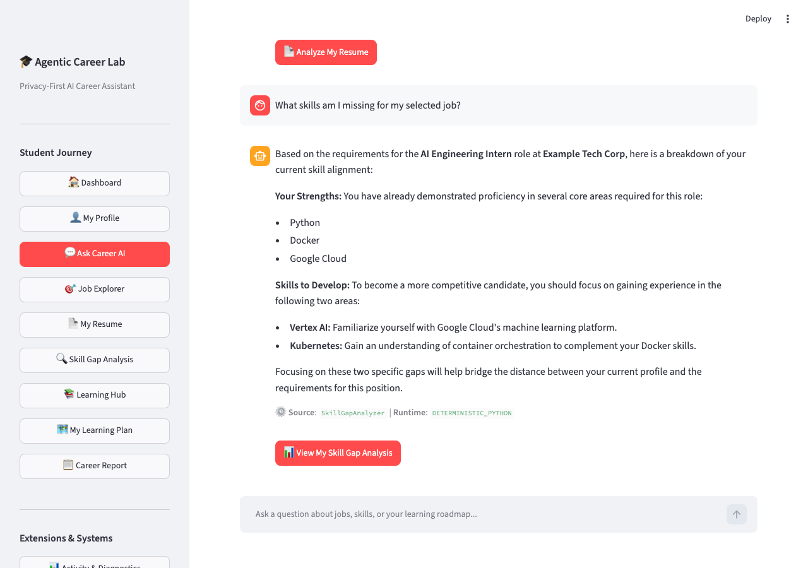
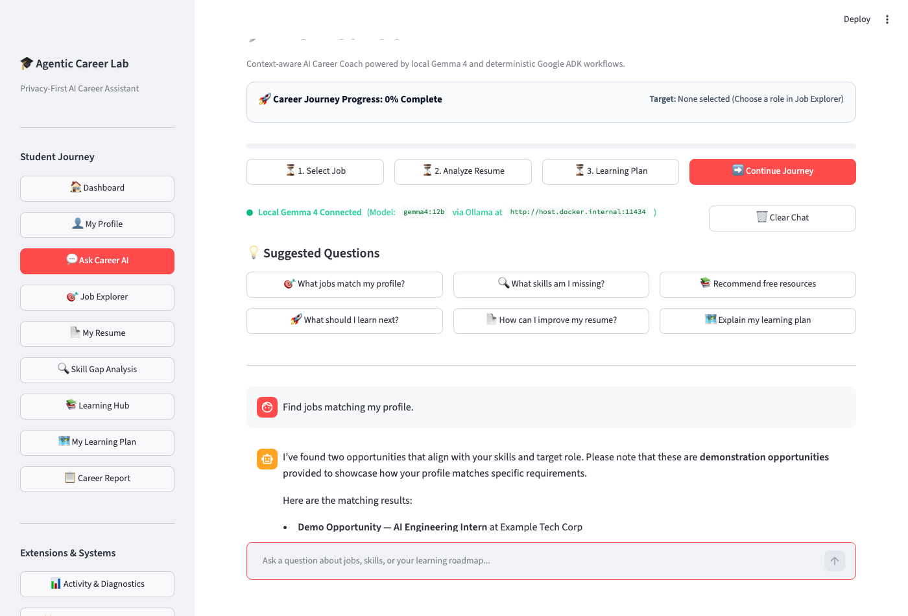
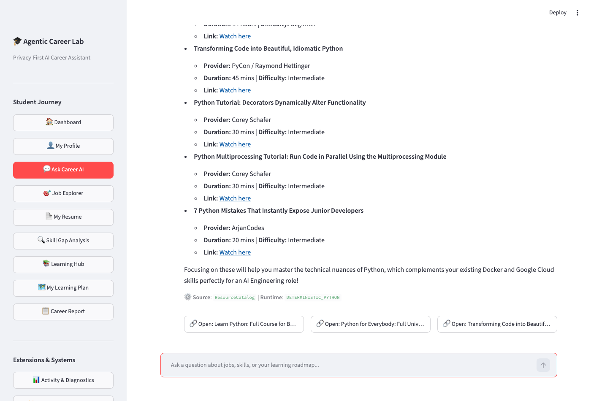
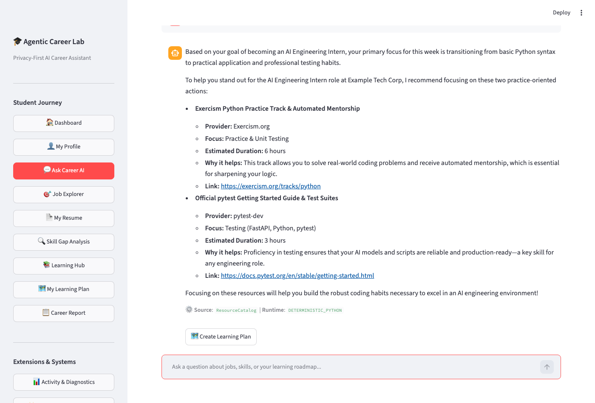
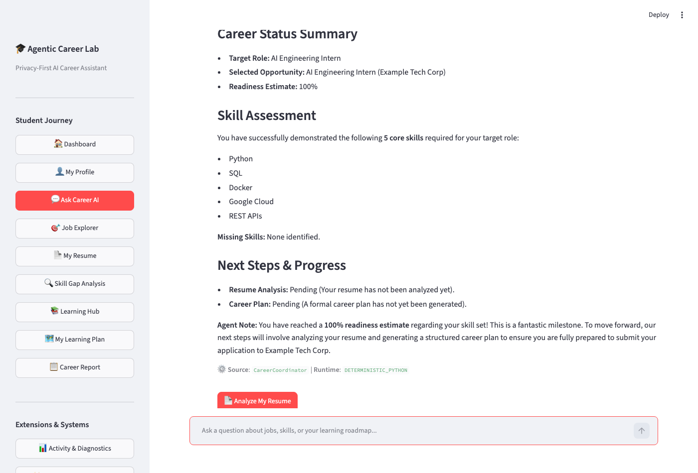

# AI Career Agent Chat Foundation Architecture (M10.1)

## 1. Overview
The **AI Career Agent Chat Foundation** introduces a context-aware conversational reasoning interface to Agentic Career Lab.
It enables students to engage in multi-turn dialogues with their AI Career Coach while upholding strict local-first privacy, deterministic factual grounding, and explicit consent boundaries for cloud synthesis.

```
                           +----------------------------------------+
                           |           Student Message              |
                           +----------------------------------------+
                                               |
                                               v
                           +----------------------------------------+
                           |        CareerChatOrchestrator          |
                           |   (Intent Classification & Context)    |
                           +----------------------------------------+
                                  /            |             \
                                 /             |              \
                 Prerequisites? /              |               \ Intent-to-Tool
                               /               |                \
                              v                |                 v
            +--------------------+             |       +--------------------+
            | Missing Context    |             |       | CareerChatTool     |
            | Request (No Fake)  |             |       | Adapters           |
            +--------------------+             |       +--------------------+
                                               |                 |
                                               | Provenance      | Grounded Facts
                                               | & Sanitized     | (Zero PII)
                                               | Data            v
                                               |       +--------------------+
                                               |       | - JobScoutAgent    |
                                               |       | - ResourceCatalog  |
                                               |       | - SkillBuilder     |
                                               |       +--------------------+
                                               v
                           +----------------------------------------+
                           |          Privacy & Consent Guard       |
                           |   (PII Scrubbing, Cloud Blocking)      |
                           +----------------------------------------+
                                  /                          \
                    Default      /                            \ Opt-In Only
                    Local First /                              \ (Explicit Consent)
                               v                                v
            +--------------------+                    +--------------------+
            | Local Gemma 4      |                    | Google Gemini      |
            | (Ollama: gemma4:12b|                    | (Cloud Synthesis)  |
            +--------------------+                    +--------------------+
```

---

## 2. Intent-to-Tool Routing Table

The orchestrator maps conversational intents deterministically to backend services and agents:

| Intent | Trigger Scenarios | Tool Adapter | Backend Service / Provenance | Required Context |
| :--- | :--- | :--- | :--- | :--- |
| `FIND_JOBS` | "Find jobs for an AI intern", "Search available roles" | `find_jobs` | `JobScoutAgent` (`MockOpportunityProvider` / `Adzuna`) | `target_role`, `demonstrated_skills` |
| `EXPLAIN_SKILL_GAPS` | "What are my skill gaps?", "Why am I not qualified?" | `explain_skill_gaps` | `SkillGapAnalyzer` (Requirement & Resume evidence) | `selected_opportunity_id`, `resume_analyzed` |
| `RECOMMEND_RESOURCES` | "Recommend tutorials for Python", "Where can I learn Docker?" | `recommend_resources` | `ResourceCatalog` (104 canonical resources) | `skills`, optional `category` filter |
| `EXPLAIN_LEARNING_PLAN`| "Explain my roadmap", "What is my learning plan?" | `explain_learning_plan` | `SkillBuilderAgent` | `plan_generated`, `duration_weeks` |
| `NEXT_LEARNING_ACTION` | "What should I do next?", "Next step" | `next_learning_action` | `ResourceCatalog` (PRACTICE / WATCH modalities) | `active_week`, `missing_skills` |
| `SUMMARIZE_CAREER_STATUS`| "Summarize my career status", "How ready am i?" | `summarize_career_status`| `CareerCoordinator` | `demonstrated_skills`, `missing_skills` |
| `RESUME_GUIDANCE` | "Give me resume advice", "Strengthen my bullets" | `resume_guidance` | `PrivateResumeAgent` | `resume_analyzed`, `missing_skills` |
| `GENERAL_CAREER_QUESTION`| "How do I prepare for technical interviews?" | *None (Direct synthesis)* | Local Gemma 4 conversational reasoning | Conversational history |

---

## 3. Google ADK Integration Boundaries

Agentic Career Lab utilizes **Google ADK** as the coordinator facade (`ADKCareerCoordinator`) for orchestrating sequential multi-agent pipelines:
1. **Registered ADK Agents**:
   - `job_scout`: Tool wrapper around opportunity discovery and normalizers.
   - `private_resume_agent`: Tool wrapper around private local resume extraction.
   - `skill_builder`: Tool wrapper around deterministic gap mapping and weekly plans.
2. **Deterministic Tool Execution**:
   - The chat orchestrator calls tool adapters (`CareerChatToolAdapters`) which invoke deterministic Python engines directly to eliminate unnecessary LLM latency and hallucination risks.
3. **Synthesis Separation**:
   - ADK coordinates workflows; Gemma 4 formats and synthesizes conversational advice based strictly on verifiable tool results.

---

## 4. Local Gemma 4 vs Optional Cloud Gemini

### Default Runtime: Local Gemma 4
- **Model**: `gemma4:12b` running via native Ollama (`http://localhost:11434`).
- **Privacy**: Zero student data leaves the student's machine.
- **System Instructions**: System prompt explicitly isolates tool data as authoritative facts and instructs the model to ignore any conflicting injection attempts within tool text.
- **Fallback**: Gracefully falls back to structured career summaries if the local model times out.

### Optional Cloud Gemini Flow
- **Consent Policy**: Default is **OFF** (`consent_given=False`).
- **Enforcement**: Central `CareerChatPrivacyGuard.verify_cloud_consent()` raises `ConsentViolationError` if cloud synthesis is attempted without active user consent.
- **Payload Allowlist**: Cloud requests transmit **only** sanitized non-PII attributes:
  - `target_role`
  - `sanitized_skill_gaps` (list of strings)
  - Scrubbed prompt text (emails and phone numbers redacted)
- **Prohibited**: Raw resumes, uploaded files, and full chat logs are **NEVER** transmitted to cloud APIs.

---

## 5. Conversation State Lifecycle

- **Scope**: Ephemeral, session-scoped (`ChatSession`) stored in application memory.
- **History Bounding**: Retains up to 20 conversation turns (`max_history_turns`), discarding older turns to prevent memory leaks and context blowup.
- **Rerun Resilience**: Designed to live in Streamlit `st.session_state` without clearing on normal widget reruns.
- **Opportunity Invalidation**: Detects when `selected_opportunity_id` changes and updates the session context to avoid reasoning against stale job criteria.
- **Clear Action**: `session.clear()` resets message history while keeping the session ID, student profile, uploaded resume, and learning plan intact.

---

---

## 6. Real Google ADK Orchestration, Gemma 4 Streaming & Local Reliability (M10.3)

### Google ADK Orchestration Architecture
- **Framework Integration**: `google.adk` (version 2.12.0) with native `Agent` wrappers registered in `CareerChatToolAdapters`.
- **Coordinator**: `ADKCareerCoordinator` acts as the primary coordinator, wiring `JobScoutAgent`, `ResourceCatalog`, and `SkillGapAnalyzer` directly into ADK tool execution pipelines.
- **Runtime Execution**: Tool adapters execute through `ExecutionRuntime.GOOGLE_ADK`, recording provenance as `JobScoutAgent (ADK Coordinated)` while ensuring zero-hallucination deterministic validation.

### Gemma 4 Real Token Streaming
- **Native Ollama Streaming**: Uses Ollama's `/api/generate` with `"stream": True` via `httpx.stream("POST", ...)`. Progressive token chunks are yielded in real-time directly to the UI.
- **Streamlit Progressive Rendering**: Consumed via `st.write_stream` and progressive cursor buffers (`▌`) in `app.py`.
- **Status Phasing**: Distinct visual transitions between `Using Google ADK career tools...` (deterministic execution) and `Generating locally with Gemma 4...` (LLM synthesis).
- **No Simulated Streaming**: Artificial word-by-word sleeps are strictly forbidden; chunks represent actual HTTP stream responses.

### Grounded Job Labeling & Sourcing
- **Demo / Mock Opportunities**: Explicitly labeled as `Demo Opportunity — Example Tech Corp` whenever backed by `MockOpportunityProvider`.
- **Live Opportunities**: Tagged as `Live Job Source: <Provider>` (e.g. Adzuna) only when backed by external live job providers.
- **System Prompt Guard**: Gemma 4 is strictly instructed never to fabricate or misrepresent mock positions as live vacancies.

### Model Timeout, Cold Starts & Recovery
- **Timeout Configuration**:
  - `OLLAMA_TIMEOUT=180.0`: Extended read timeout accommodates initial cold-start loading of the 12B parameter weights into memory.
  - `OLLAMA_CONNECT_TIMEOUT=10.0`: Fast connection failure detection for offline host services.
  - Fine-grained HTTP streaming prevents intermediate client read timeouts.
- **Error Recovery**: In the event of an Ollama timeout or host disconnection, retrieved ADK tool results are preserved and rendered to the student alongside a clear retry trigger, avoiding Python tracebacks or lost context.

---

## 7. Interactive Evidence-Based Skill Gap Analysis Action (M10.4)

### Structured ChatAction Contract
Interactive conversational actions are defined via the typed `ChatAction` Pydantic model (`src/agentic_career_lab/chat/models.py`) rather than parsed from arbitrary LLM text:
- `action_id`: Unique identifier (`act_...`).
- `action_type`: Strictly validated `ChatActionType` enum (`OPEN_SKILL_GAP_ANALYSIS`, `NAVIGATE_JOB_EXPLORER`, `NAVIGATE_MY_RESUME`, `NAVIGATE_LEARNING_PLAN`).
- `label`: Human-readable button label (e.g. `"View My Skill Gap Analysis"`).
- `enabled`: Boolean controlling whether action can be triggered in the active context.
- `disabled_reason`: Descriptive explanation if prerequisites are not satisfied.
- `target_page`: Canonical internal page destination (`ui_helpers.py`), preventing arbitrary web redirects or malicious URLs.
- `selected_opportunity_id`: Bound opportunity ID ensuring that comparisons belong to the intended target role.
- `required_context`: Prerequisites list enforced prior to action activation.

### Missing-Context & Stale Job Lifecycle
The system deterministically evaluates context completeness before presenting actions:
- **Case A (No Job Selected)**: Assistant prompts *"Select a job before comparing your resume against its requirements."* and renders a `"Choose a Job"` action button navigating directly to `Job Explorer`.
- **Case B (Job Selected, Resume Not Analyzed)**: Assistant prompts *"Analyze your resume privately before viewing evidence-based skill gaps."* and renders an `"Analyze My Resume"` action button navigating to `My Resume`.
- **Case C (Job Changed / Stale Analysis)**: When a student selects a different opportunity in Job Explorer, stale comparisons and learning plans are automatically invalidated (`resume_analysis = None`, `skill_builder_plan = None`), prompting fresh local extraction.
- **Case D (Valid Job & Analyzed Resume)**: Assistant delivers grounded skill gap guidance and renders the primary `"View My Skill Gap Analysis"` action button.

### Evidence Accuracy & Navigation Preservation
When the student clicks `"View My Skill Gap Analysis"`:
1. Native Streamlit button dispatches centralized `navigate(SKILL_GAP_ANALYSIS)` without page reloads or tab spawning.
2. Canonical evidence classifications remain untampered:
   - **Demonstrated with Evidence** (verified via technical deliverables or work experience).
   - **Mentioned / Partially Evidenced** (coursework or keywords lacking production metrics).
   - **Missing Requirements** (job requirements with zero resume evidence).
3. Student profile, uploaded resume text, learning plan progress, and multi-turn chat history are fully preserved across navigation.



---

## 8. Complete Interactive Career Actions (M10.4 Extension)

The interactive action system is extended to support comprehensive end-to-end career guidance actions directly from conversation turns, ensuring students act on verified agent results rather than reading static conversational text.

### Supported ChatAction Types
1. `SELECT_JOB`:
   - **Trigger Scenarios**: "Find jobs matching my profile", "Show AI engineering internships", "Help me choose a job".
   - **Generation**: Generated deterministically from `JobScoutAgent` tool results for actual matched opportunities.
   - **Provenance & Labeling**: Mock provider results are explicitly labeled as `Demo Opportunity — <Company>`, while live providers (Adzuna) are accurately designated.
   - **Validation**: At click time, `opportunity_id` is validated against trusted search results (`job_matches` or provider query fallback) to reject arbitrary model-supplied IDs.
   - **State Invalidation**: Selecting a new job automatically invalidates stale resume analyses and generated learning plans while preserving student profile details and uploaded resume text.
   - **Navigation**: Directly navigates to `My Resume` via `navigate(MY_RESUME)`.

2. `OPEN_LEARNING_RESOURCE`:
   - **Trigger Scenarios**: "Recommend free Docker courses", "Show Kubernetes labs", "Find Python videos".
   - **Generation**: Generated from verified `ResourceCatalog` recommendations (104 curated resources).
   - **Metadata**: Includes resource title, category (`WATCH` / `LEARN` / `PRACTICE` / `BUILD`), provider, and free-tier status.
   - **Security & Integrity**: Canonical URLs are looked up directly from `ResourceCatalog` by `resource_id` at render/click time. Only safe `https://` URLs are rendered via `st.link_button`. No personal profile, resume data, or query tokens are exposed in external links. Opening a link does not automatically mark the activity complete.

3. `CONTINUE_LEARNING`:
   - **Trigger Scenarios**: "What should I learn next?", "Continue my learning plan", "What is my next task?".
   - **Plan Inspection**: Inspects the student's existing learning plan (`skill_builder_plan`) and weekly checklist state.
   - **Deterministic Fallback**: If no plan exists, renders `"Create your learning plan to continue learning"` navigating directly to `My Learning Plan`. If all activities are completed, offers `"View Career Report"`.
   - **Navigation**: Directly navigates to `My Learning Plan` via canonical Streamlit navigation (`navigate(MY_LEARNING_PLAN)`), preserving task evidence notes and completion percentages.

4. `VIEW_CAREER_REPORT`:
   - **Trigger Scenarios**: "Show my career report", "Summarize my career progress", "Open my career action report".
   - **Prerequisites Validation**: Confirms that a target job is selected, resume analysis is performed, and learning plan is generated before navigating to `Career Report`.
   - **Deterministic Guidance**: If prerequisites are missing, guides the student step-by-step to the earliest incomplete step (`Job Explorer`, `My Resume`, or `My Learning Plan`).
   - **Navigation**: Navigates to `Career Report` with full Markdown download capabilities intact.

### Privacy and Trust Boundaries
- **Strictly Local Execution**: All action generation, intent routing, and resume extraction remain 100% local using Gemma 4 via Ollama.
- **Zero Cloud Leakage**: Cloud Gemini consent remains **OFF** by default. No raw resume data or private identifiers are stored in action metadata or URL parameters.
- **Typed Action Contracts**: Strictly typed optional target fields (`opportunity_id`, `resource_id`, `learning_week`, `learning_task_id`) on `ChatAction` ensure zero arbitrary dictionary payload parsing.

### Visual Evidence & Acceptance Screenshots

| Flow | Action Captured | Screenshot |
| :--- | :--- | :--- |
| **Flow A** | `SELECT_JOB` Action |  |
| **Flow B** | `OPEN_LEARNING_RESOURCE` Action |  |
| **Flow C** | `CONTINUE_LEARNING` Action |  |
| **Flow D** | `VIEW_CAREER_REPORT` Action |  |

---

## 9. Implementation Status and Roadmap

- **M10.1 (Complete)**: AI Career Agent Chat Foundation (Domain Models, Tool Adapters, Orchestration, Privacy Guard, Unit Tests, Architecture Docs).
- **M10.2 (Complete)**: Working Streamlit "Ask Career AI" Chatbox (UI Layout, Suggested Prompt Chips, Conversation State).
- **M10.3 (Complete)**: Real Google ADK Orchestration, Gemma 4 Token Streaming, and Local Model Reliability.
- **M10.4 (Complete)**: Interactive Evidence-Based Skill Gap Analysis Action (Typed `ChatAction` contract, deterministic lifecycle, verified browser acceptance).
- **M10.4 Extension (Complete)**: Complete Interactive Career Actions (`SELECT_JOB`, `OPEN_LEARNING_RESOURCE`, `CONTINUE_LEARNING`, `VIEW_CAREER_REPORT`, state invalidation, HTTPS catalog links, full Playwright acceptance).
- **M10.5 (Next)**: Cloud Gemini synthesis toggle with explicit consent modal and settings dashboard.
- **M10.6**: Multi-agent conversational memory benchmarks and telemetry validation.
